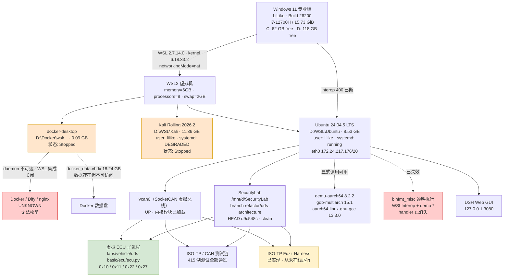

# SecurityLab Environment Inventory

> 车联网安全 / 网络安全实验环境 —— 现状盘点与验收基线
>
> **本次任务性质：只读盘点。** 全程未安装、未卸载、未修改任何配置、未启动/停止/重启任何服务、
> 未修改 Git 仓库内容、未删除任何文件、未执行任何破坏性 fuzz / 攻击 / 写入 / 刷固件操作。
> 所有结论均来自本次实际执行的命令；历史文档与 README 仅作为检查线索，不作为证据。

---

## 1. 文档信息

| 项目 | 值 |
| --- | --- |
| 文档名称 | `docs/ENVIRONMENT_INVENTORY_2026-09-17.md` |
| 盘点日期 | 2026-09-17 |
| 盘点时间窗口 | 15:57 – 16:20（CST，UTC+8） |
| 盘点主机 | `LiLike`（Windows 11 专业版，WSL2） |
| 盘点执行环境 | WSL2 Ubuntu 24.04.5，用户 `lilike` |
| 盘点方式 | 只读系统命令 + 项目自带测试入口 + `~/.venvs/network` 内 Python 验证；Windows 侧通过 `powershell.exe` / `wsl.exe` interop 查询 |
| Git 仓库 | `/mnt/d/SecurityLab` |
| Git 分支 | `refactor/uds-architecture` |
| Git commit | `d9c548ceb6f12c1eb3dc5ffce797abcf5a465406` |
| 工作树状态 | **clean**（盘点前后均无改动；盘点中临时创建的 `.audit-tmp/` 已删除并复核 clean） |
| 冻结说明 | 本文件为 2026-09-17 15:57–16:20 的快照。期间环境发生了一次自发性变化（见 §12 问题 P-01）。 |

### 状态体系（全文统一使用）

| 状态 | 含义 |
| --- | --- |
| **VERIFIED** | 已通过实际命令运行并确认功能可用 |
| **INSTALLED** | 确认已安装，但未完成完整功能验证 |
| **PRESENT** | 发现相关文件/目录/包，但无法确认组件完整或可用 |
| **PARTIAL** | 已存在但缺失关键部分 |
| **NOT FOUND** | 未找到 |
| **UNKNOWN** | 当前无法安全或无法技术性确认 |

---

## 2. Executive Summary

| 子系统 | 状态 | 完成度 | 关键问题 |
| --- | --- | --: | --- |
| Windows | VERIFIED | 100% | C: 仅剩 62 GB（70% 已用）；WSL 内存上限 6 GB 偏紧 |
| WSL | PARTIAL | 80% | **Windows↔Linux interop 在盘点中失效（`WSLInterop` binfmt handler 消失）**；默认发行版以 GUID 形式返回；Docker Desktop WSL 集成关闭 |
| Ubuntu | VERIFIED | 95% | 缺少 `ninja` / `go` / `java` / `strace` / `ltrace`；PATH 混入大量 Windows 目录 |
| Kali | PARTIAL | 60% | systemd `degraded`（4 个失败单元，含 `user@1000.service`）；无 gdb / socat / QEMU / ARM 交叉工具链 / tshark |
| Docker | NOT FOUND | 0–5% | **Docker Desktop 未运行、daemon 不可达、WSL 集成关闭；无法枚举任何容器/镜像/网络** |
| SecurityLab | VERIFIED | 90% | 47 个受版本控制文件，工作树 clean；`docs/` 目录此前不存在 |
| CAN | VERIFIED | 90% | SocketCAN + vcan0 + can-utils + python-can 全部实测可用；无真实 CAN 硬件 |
| ISO-TP | VERIFIED | 85% | 内核 `can_isotp` 已加载，收发/畸形分帧全链路实测通过；fuzz campaign 未运行 |
| UDS | VERIFIED | 75% | 4 个服务（0x10/0x11/0x22/0x27）+ NRC + SecurityAccess 实测通过；0x2E/0x19/0x31/0x3E 未实现 |
| ECU | VERIFIED | 70% | **测试桩级虚拟 ECU**（Python 子进程），非真实 ECU、非产物级模拟器 |
| Firmware | PARTIAL | 35% | binwalk/unsquashfs 链路实测可用，但**唯一固件样本是 4 KB x86-64 demo，非真实设备固件** |
| ARM | VERIFIED | 70% | AArch64 交叉编译 + QEMU 执行 + gdb-multiarch 反汇编实测通过；无 32 位 ARM(gnueabihf) 工具链、无 Ghidra |
| Fuzz | PARTIAL | 55% | 引擎/变异/schema/oracle 代码完整，离线 121 例通过；**从未运行过任何 campaign，`fuzz-out/` 为空** |
| Replay | PARTIAL | 50% | 代码与单元测试完整，但**从未对任何已保存 testcase 做过端到端 replay** |
| AI Agent | VERIFIED | 80% | DSH 0.1.5-rc.1 正常；Codex CLI 0.154.0 已装；无 Claude Code / Gemini；无 MCP 配置 |

---

## 3. Host Environment

全部数据来自 `powershell.exe` + `Get-CimInstance`。

| 项目 | 值 |
| --- | --- |
| 操作系统 | Microsoft Windows 11 专业版 |
| 版本 | 10.0.26200 |
| Build | 26200（`Windows: 10.0.26200.9457`） |
| 系统架构 | 64 位 |
| 主机名 | `LiLike` |
| 制造商 / 型号 | LENOVO / 83BF |
| CPU | 12th Gen Intel(R) Core(TM) i7-12700H |
| CPU 核心 | 14 物理核 / 20 逻辑处理器 |
| CPU 主频 | 2300 MHz（标称） |
| 物理内存 | 16,890,322,944 B ≈ **15.73 GiB** |
| 磁盘 | UMIS RPJYJ512MKN1QWY，SSD，NVMe，476.94 GB |
| 安装日期 | 2026-04-11 |
| 上次启动 | 2026-09-15 21:11:48 |

### 卷与剩余空间

| 卷 | 卷标 | 总容量 | 剩余 | 已用 |
| --- | --- | --: | --: | --: |
| C: | Windows-SSD | 200.39 GB | **61.22 GB** | 69.4% |
| D: | 新加卷 | 274.32 GB | **117.6 GB** | 57.1% |

**资源问题判断：** C: 剩余 61 GB 对开发可用，但已用 69.4%，需持续关注。
物理内存 15.73 GiB 而 WSL 被限制为 6 GB（见 §4），两者合计仍有余量，不构成当前瓶颈。

---

## 4. WSL Environment

### 4.1 WSL 平台信息（`wsl --status` / `wsl --version` / `wsl --list --verbose`）

| 项目 | 值 |
| --- | --- |
| WSL 版本 | **2.7.14.0** |
| 内核版本 | **6.18.33.2-2**（`uname -r` 实测 `6.18.33.2-microsoft-standard-WSL2`） |
| WSLg | **1.0.73.2**（已启用） |
| MSRDC | 1.2.7214 |
| Direct3D | 1.611.1-81528511 |
| DXCore | 10.0.26100.1-240331-1435.ge-release |
| WSL 默认版本 | 2 |
| 默认发行版 | 报告为 GUID `{3deeb009-46bf-4196-ad38-07ab50730b4f}`（**未返回友好名称**，见 P-04） |

### 4.2 发行版清单与状态

| 名称 | 状态 | WSL 版本 | 存储位置（BasePath） |
| --- | --- | :-: | --- |
| **Ubuntu** | **Running**（默认） | 2 | `\\?\D:\WSL\Ubuntu` |
| kali-linux | Stopped | 2 | `\\?\D:\WSL\Kali` |
| docker-desktop | Stopped | 2 | `\\?\D:\Docker\wsl\DockerDesktopWSL\main` |

**已迁移到 D 盘：确认是。** 三个发行版 BasePath 全部位于 D:。

### 4.3 WSL 虚拟磁盘实际占用

| 文件 | 磁盘占用 |
| --- | --: |
| `D:\WSL\Ubuntu\ext4.vhdx` | 8.53 GB |
| `D:\WSL\Kali\ext4.vhdx` | 11.36 GB |
| `D:\Docker\wsl\DockerDesktopWSL\main\ext4.vhdx` | 0.09 GB |
| `D:\Docker\wsl\DockerDesktopWSL\disk\docker_data.vhdx` | **18.24 GB** |
| `D:\WSL\swap.vhdx` | 0.04 GB |
| **合计** | **≈ 38.3 GB** |

> `docker_data.vhdx` 的 18.24 GB 说明 Docker 数据盘上确实存在历史数据，
> 但本次 **daemon 不可达，无法枚举其中内容**（见 §5）。

### 4.4 `.wslconfig`（`C:\Users\20771\.wslconfig`，完整内容）

```ini
[wsl2]
memory=6GB
processors=8
swap=2GB
swapFile=D:\\WSL\\swap.vhdx
networkingMode=nat
```

| 关键项 | 配置值 | 实测确认 |
| --- | --- | --- |
| memory | 6GB | VERIFIED —— `free -h` 显示 `Mem: 5.8Gi`；`MemTotal: 6067832 kB` |
| processors | 8 | VERIFIED —— `nproc` = 8；`lscpu` CPU(s)=8（4 核 × 2 线程） |
| swap | 2GB | VERIFIED —— `Swap: 2.0Gi`；`SwapTotal: 2097152 kB` |
| swapFile | `D:\WSL\swap.vhdx` | VERIFIED —— 文件存在，0.04 GB |
| networkingMode | nat | VERIFIED —— 见 §10 |

**不存在其它 WSL 资源限制项**（无 `[experimental]`、无 `autoMemoryReclaim`、无 `sparseVhd`）。

### 4.5 Ubuntu 内资源实测

```
$ free -h
               total   used   free  shared  buff/cache  available
Mem:           5.8Gi  1.1Gi  4.6Gi  3.5Mi       278Mi      4.7Gi
Swap:          2.0Gi     0B  2.0Gi

$ nproc
8
```

| 项目 | 实测值 |
| --- | --- |
| 可用内存 | 5.8 GiB 总量 / 4.7 GiB available |
| CPU 核数 | 8（12th Gen i7-12700H，虚拟化 full，VT-x） |
| Swap | 2.0 GiB，使用 0 B |
| 根文件系统 | `/dev/sdd`，ext4，1007 GB 可见，已用 7.0 GB |
| `/mnt/c` | 9p，201 GB，剩 62 GB |
| `/mnt/d` | 9p，275 GB，剩 118 GB |
| WSL 虚拟磁盘 | `/dev/sdd` 1 TB 逻辑（实际 vhdx 8.53 GB）；`/dev/sdc` 2 GB = SWAP |
| 异常磁盘占用 | **未发现异常**；根文件系统实际用量 7.0 GB 与 vhdx 8.53 GB 相符 |

### 4.6 关键发现：发行版启动引发 interop 失效

盘点过程中，`wsl.exe -d kali-linux` 调用之后，Windows↔Linux interop **整体失效**：

```
$ ls /proc/sys/fs/binfmt_misc/
register  status          ← 仅剩两个文件，所有 handler 消失
```

- `WSLInterop` handler 消失 → 所有 `.exe`（`cmd.exe` / `powershell.exe` / `wsl.exe`）无法执行，
  改为被 shell 当作文本解析：`/mnt/c/WINDOWS/system32/cmd.exe: 1: MZ...: not found`
- `qemu-*` handler 也一并消失（`0 qemu entries`）
- 关联内核日志（`dmesg`）：
  - `[ 5488.98] sd 0:0:0:4: [sde] 2147483648 512-byte logical blocks: (1.10 TB/1.00 TiB)`
  - `[ 5489.19] EXT4-fs (sde): mounted filesystem 8b2a98b4-... r/w`
  - `[ 5607.41] EXT4-fs (sde): unmounting filesystem 8b2a98b4-...`
  - 即 Kali 发行版启动时热挂载了一个 1 TiB 磁盘，随后卸载
- **VM 本身未重启**：`uptime -s` = 2026-09-17 14:40:40，`ps -p 1` elapsed 01:35:50，
  systemd PID 1 自 14:40:41 持续运行；`dmesg` 首行 `[0.000000] Linux version ...` 后直接跳到 `[5488]`
- 影响面：**仅影响 Windows 互操作与 binfmt 透明执行**。
  **显式调用 `qemu-aarch64` 仍完全正常**（见 §11 验证 V-14），
  SecurityLab 的 ISO-TP / vcan0 / 测试链**未受影响**（16:18 复跑 65 例 e2e 仍全部通过）。

---

## 5. Docker Environment

### 5.1 Docker 本体

| 检查项 | 结果 | 状态 |
| --- | --- | --- |
| Docker Desktop 安装 | `C:\Program Files\Docker\Docker\Docker Desktop.exe` 存在（13.18 MB，2026-05-13） | INSTALLED |
| Docker Desktop 进程 | **无任何 `*docker*` 进程在运行** | NOT FOUND（未运行） |
| `com.docker.service` | **查询无结果**（服务名不存在或未安装） | NOT FOUND |
| Docker daemon 命名管道 | `\\.\pipe\dockerDesktopLinuxEngine` → **False** | NOT FOUND |
| Ubuntu 内 `docker` CLI | `/usr/bin/docker` → `/mnt/wsl/docker-desktop/cli-tools/usr/bin/docker`，**符号链接目标不存在** | PARTIAL（悬空链接） |
| `/mnt/wsl/docker-desktop/` | **不存在** | NOT FOUND |
| Ubuntu 内 `docker` 命令行为 | 落到 Docker Desktop 的 Windows 包装脚本（`C:\Program Files\Docker\Docker\resources\bin\docker`），输出：`The command 'docker' could not be found in this WSL 2 distro.` | NOT FOUND |
| Ubuntu `docker` 用户组 | 存在（`docker:x:1001:lilike`），用户已加入；**GID 1001 落在用户范围内，存在冲突隐患**（见 P-16） | VERIFIED |
| Docker Desktop WSL 集成 | `EnableIntegrationWithDefaultWslDistro = False`，`IntegratedWslDistros = None` | PARTIAL（已关闭） |
| Docker Desktop 自启 | `AutoStart = False` | PARTIAL |
| Docker context（Windows 侧） | `desktop-linux`，指向 `npipe:////./pipe/dockerDesktopLinuxEngine` | PRESENT |

**`docker version` / `docker info` / `docker context ls` 全部无法取得真实结果**：
命令在 Ubuntu 内被 Docker Desktop 的 WSL 包装脚本拦截并直接退出，
未能触达任何 daemon。

### 5.2 容器

**无法枚举。** 由于 daemon 不可达，`docker ps` / `docker ps -a` 均未能返回结果。

针对任务中特别点名的组件，本次的**唯一**可确证结论是：

| 组件 | 本次结论 |
| --- | --- |
| nginx | **UNKNOWN**（daemon 不可达，无法确认存在与否） |
| Dify（api / worker / web / plugin_daemon / websocket） | **UNKNOWN** |
| postgres | **UNKNOWN** |
| redis | **UNKNOWN** |
| weaviate | **UNKNOWN** |
| ssrf_proxy | **UNKNOWN** |

> **明确声明：本次未发现任何证据表明上述容器正在运行，也未发现证据表明它们不存在。**
> 不能因为磁盘上存在 18.24 GB 的 `docker_data.vhdx` 就推断「Dify 集群已部署」，
> 也不能因为 daemon 未运行就推断「Dify 集群不存在」。
> 如需验收 Dify，必须先启动 Docker Desktop（属修改环境，本次禁止）。

### 5.3 镜像 / 网络 / 卷

| 检查项 | 结果 |
| --- | --- |
| `docker images` | UNKNOWN（daemon 不可达） |
| `docker network ls` | UNKNOWN（daemon 不可达） |
| `docker volume ls` | UNKNOWN（daemon 不可达） |
| 端口冲突 | UNKNOWN（无容器端口映射可查；Ubuntu 侧监听见 §10） |

### 5.4 Docker 配置文件（只读读取）

`C:\Users\20771\.docker\daemon.json` —— 配置了 4 个镜像加速器：

```json
{
  "registry-mirrors": [
    "https://docker.unsee.tech",
    "https://docker.1panel.live",
    "https://hub.ratels.pro",
    "https://docker.anyhub.us.kg"
  ]
}
```

`C:\Users\20771\.docker\windows-daemon.json`：`{"experimental": false}`

`C:\Users\20771\.docker\config.json`：`"auths": {}`（空）、`credsStore: desktop`、
`currentContext: desktop-linux`，启用了 `ai` / `compose` / `debug` / `scout` 插件钩子。
**未发现明文凭据。**

---

## 6. SecurityLab Repository

### 6.1 Git 状态

| 项目 | 值 |
| --- | --- |
| 路径 | `/mnt/d/SecurityLab` |
| 当前分支 | `refactor/uds-architecture` |
| HEAD commit | `d9c548ceb6f12c1eb3dc5ffce797abcf5a465406` |
| HEAD 摘要 | `docs(can-tools): document BS remaining-CF boundary and test count` |
| 工作树 | **clean**（`nothing to commit, working tree clean`） |
| 本地分支 | `main`、`refactor/uds-architecture` |
| 远程分支 | `remotes/origin/main` |
| remote | `origin  git@github.com:Li20771/SecurityLab.git`（SSH） |
| 受版本控制文件数 | **47** |

### 6.2 最近 20 个提交

```
d9c548c docs(can-tools): document BS remaining-CF boundary and test count
c3c9f62 feat(can-tools): add remaining-CF-count BS boundary mutation
83fb38b feat(can-tools): add stateful ISO-TP fuzz harness
126dcdf fix(isotp): contain overflow transport error
9ee291d docs(test): drop stale expectedFailure claim in cable helper
c884aad fix(isotp): contain transport socket errors
34cdf33 test(can-tools): add malformed ISO-TP experiments
94b4da1 feat(isotp): make transport options explicit
eb38a56 feat(can-tools): add CAN and ISO-TP lab utilities
1104c00 docs(uds): document phase 3 architecture
19201e6 refactor(uds): tighten ECU compatibility boundary
8866713 refactor(uds): move dispatcher to uds server
33b5ec1 refactor(uds): add service registry
6eddde0 refactor(uds): extract security access handler
414b406 refactor(uds): extract basic service handlers
87c1852 test(uds): migrate unit tests to explicit ECU state
f52766b refactor(uds): introduce explicit ECU state
19eb046 refactor(uds): centralize response and NRC handling
754c575 refactor(uds): add protocol constants and response builders
e215b1d test(uds): add securityAccess unit and vcan0 e2e coverage
```

**最近完成的内容：** UDS 架构重构（`refactor/uds-architecture` 分支，19eb046→19201e6）
→ CAN/ISO-TP 实验工具（eb38a56）→ 传输参数显式化（94b4da1）→ 畸形分帧实验（34cdf33）
→ transport error containment（c884aad、126dcdf）→ **有状态 ISO-TP fuzz harness（83fb38b、c3c9f62、d9c548c）**。
最后三个提交即任务中提到的 **Phase 4X-P1**。

### 6.3 目录结构

```
/mnt/d/SecurityLab/
├── .gitignore
├── AGENTS.md                    # Agent 工作规范
├── README.md
├── artifacts/                   # 空目录
├── configs/
│   ├── environment/
│   │   ├── baseline.txt
│   │   └── python-network-requirements.txt
│   └── systemd/
│       └── vcan0.service
├── ctf/  data/  notes/  pcaps/  projects/  reports/  reverse/  tmp/   # 空目录
├── firmware/                    # 空目录
├── labs/
│   ├── firmware/binwalk-basic/
│   ├── reverse/{hello,arm64}/
│   └── vehicle/
│       ├── can-basic/
│       ├── can-tools/
│       ├── fuzz-out/            # gitignored，空（仅 README 占位）
│       ├── fuzz-tmp/            # gitignored，空（仅 README 占位）
│       └── uds-basic/
├── scripts/
│   └── healthcheck.sh
└── docs/                        # 本次盘点新建
```

### 6.4 项目定位

个人网络安全与车联网安全研究环境。方向：网络安全、二进制逆向、固件分析、ARM/AArch64、
Embedded Linux、CAN/SocketCAN、ISO-TP、UDS、车联网安全、漏洞研究、安全实验自动化。
`README.md` 与 `AGENTS.md` 对此的描述与仓库实际内容**一致**。

### 6.5 模块清单（47 个受控文件）

**逆向（`labs/reverse/`）** — 4 个源文件 + 2 个 gitignored 产物

| 文件 | 说明 |
| --- | --- |
| `hello/hello.c`、`hello/hello`(ignored) | x86-64 ELF，BuildID `a2a1a42c...` |
| `arms64/…` → `arm64/hello_arm64.c`、`arm64/hello_arm64`(ignored) | ARM AArch64 静态 ELF，BuildID `63ec012c...` |

**固件（`labs/firmware/binwalk-basic/`）**

| 文件 | 说明 |
| --- | --- |
| `README.md` | 实验说明 |
| `rootfs/etc/{config.txt,version}` | 制作用于打包的 rootfs |
| `rootfs/usr/bin/ecu-demo`(ignored) | **实为 x86-64 ELF**，见 §12 P-06 |
| `demo_firmware.squashfs`(ignored) | 4 KB SquashFS 样本 |

**车联网（`labs/vehicle/`）**

| 目录 | 文件 |
| --- | --- |
| `can-basic/` | `README.md`、`demo.dbc` |
| `can-tools/` | `README.md`、`can_capture.py`、`can_inject.py`、`isotp_send.py`、`parsers.py` |
| `can-tools/fuzz/` | `__init__.py`、`isotp_corpus.py`、`isotp_mutators.py`、`case_schema.py`、`isotp_fuzz.py`、`replay.py` |
| `can-tools/tests/` | `run_tests.sh`、`test_parsers.py`、`test_isotp_send_options.py`、`test_fuzz_offline.py`、`test_isotp_malformed_vcan.py` |
| `uds-basic/ecu/` | `ecu.py`、`uds_server.py`、`uds_types.py`、`did_database.py`、`keygen.py` |
| `uds-basic/client/` | `uds_client.py`、`isotp_client.py` |
| `uds-basic/configs/` | `uds.yaml` |
| `uds-basic/tests/` | `run_tests.sh`、`test_ecu_unit.py`、`test_keygen_unit.py`、`test_e2e_vcan.py`、`test_isotp_options_vcan.py` |

**基础设施**

| 文件 | 说明 |
| --- | --- |
| `configs/systemd/vcan0.service` | vcan0 自动创建服务（已安装到 `/etc/systemd/system/` 并启用） |
| `configs/environment/python-network-requirements.txt` | 8 个固定版本依赖 |
| `configs/environment/baseline.txt` | 2026-09-13 的环境基线记录 |
| `scripts/healthcheck.sh` | 环境健康检查脚本 |

### 6.6 测试体系

- **框架：`unittest`（标准库），不是 pytest。** 全仓库无 `pytest.ini` / `conftest.py` / `pyproject.toml`。
- 入口为两个自研 bash runner：`can-tools/tests/run_tests.sh`（`all|offline|malformed`）、
  `uds-basic/tests/run_tests.sh`（`all|unit|e2e`）。
- 两者均按优先级选择解释器：`$PYTHON` → `~/.venvs/network/bin/python` → `python3`。
- vcan0 相关 runner 会先探测 `vcan0` 是否存在且 `UP`，不满足则 WARN 跳过。

### 6.7 fuzz 体系

见 §9（重点核实）。

### 6.8 replay 体系

`labs/vehicle/can-tools/fuzz/replay.py`（191 行）。设计要点（源码确证）：

- **不重新生成 mutation**，直接读取 `frames[]` 原样发送 → exact reproduction。
- replay 前后执行 recovery probe（`10 01`），复现行为而不仅是帧。
- 用 `canonical_identity()` 校验往返一致性；identity 依赖
  `case_id/seed/mutation/interface/can_ids/frames`，**刻意排除 `result`**。
- CLI 支持 `--repeat N`（确定性确认）与 `--all`（目录批量）。

### 6.9 CAN / ISO-TP 相关代码

| 文件 | 行数 | 职责 |
| --- | --: | --- |
| `can-tools/parsers.py` | 388 | 输入校验：`guard_interface`（仅允许 vcan0）、CAN ID、DLC、十六进制解析 |
| `can-tools/can_capture.py` | 144 | 链路层 RAW CAN 帧观察 |
| `can-tools/can_inject.py` | 162 | 链路层单帧注入 |
| `can-tools/isotp_send.py` | 349 | 传输层 ISO-TP payload 发送（padding / stmin / blocksize / timeout） |
| `uds-basic/client/isotp_client.py` | 155 | ISO-TP 客户端封装 |

### 6.10 ECU 相关代码

`labs/vehicle/uds-basic/ecu/`（共 1,539 行）

| 文件 | 行数 | 职责 |
| --- | --: | --- |
| `ecu.py` | 562 | ECU 进程入口 / CAN 链路 |
| `uds_server.py` | 536 | UDS 服务分发与实现（含服务注册表 `SERVICES`） |
| `uds_types.py` | 199 | 协议常量与响应构造 |
| `keygen.py` | 222 | 教学用 seed/key 算法（无 CAN 依赖） |
| `did_database.py` | 20 | DID 数据库 |

`uds_server.py` 结构（源码确证）：

```
EcuState (class)                 ← 显式 ECU 状态
SESSION_TIMING
reset_security_state()
required_security_level(did)     ← Session × Security 权限模型
service_diagnostic_session_control()   # 0x10
service_ecu_reset()                    # 0x11
service_read_data_by_identifier()      # 0x22
service_security_access()              # 0x27
_make_security_access_handler()
SERVICES = {...}                 ← 服务注册表
handle_uds_request()
```

### 6.11 协议解析相关代码

- `can-tools/parsers.py`：报文/ID/DLC/接口校验。
- `can-tools/README.md` 明确：`can_capture`/`can_inject`/`isotp_send` **不解析 UDS 语义**
  （不解析 SID/NRC/DID/SecurityAccess），只原样打印字节，以避免与 `uds_server.py` 业务耦合。
- UDS 语义解析在 `uds-basic/client/uds_client.py`（184 行）。

### 6.12 动态分析 / 自动化脚本 / Docker / CI 文档

| 项目 | 状态 |
| --- | --- |
| 动态分析代码 | **NOT FOUND**（无 ptrace/插桩/动态跟踪脚本；逆向 lab 为静态 + GDB 手工） |
| 自动化脚本 | `scripts/healthcheck.sh`（155 行）、两个 `run_tests.sh` |
| Dockerfile | **NOT FOUND** |
| docker-compose / compose.yml | **NOT FOUND** |
| CI 配置（`.github/workflows` 等） | **NOT FOUND** |
| 文档 | `README.md`、`AGENTS.md`、5 个 lab README；**`docs/` 目录此前不存在**（本次新建） |

---

## 7. 重点核实：Fuzz / ISO-TP 系统（Phase 4X-P1）

任务中列出的候选路径为仓库根 `fuzz/` 与根 `tests/`。
**现场确认为：这些文件不在仓库根，而在 `labs/vehicle/can-tools/` 下。**
根目录既无 `fuzz/` 也无 `tests/`。

### 7.1 文件是否存在（逐一核实）

| 任务预期路径 | 实际路径 | 存在 | 行数 |
| --- | --- | :-: | --: |
| `fuzz/__init__.py` | `labs/vehicle/can-tools/fuzz/__init__.py` | ✅ | 29 |
| `fuzz/isotp_corpus.py` | `labs/vehicle/can-tools/fuzz/isotp_corpus.py` | ✅ | 556 |
| `fuzz/isotp_mutators.py` | `labs/vehicle/can-tools/fuzz/isotp_mutators.py` | ✅ | 567 |
| `fuzz/case_schema.py` | `labs/vehicle/can-tools/fuzz/case_schema.py` | ✅ | 478 |
| `fuzz/isotp_fuzz.py` | `labs/vehicle/can-tools/fuzz/isotp_fuzz.py` | ✅ | 885 |
| `fuzz/replay.py` | `labs/vehicle/can-tools/fuzz/replay.py` | ✅ | 191 |
| `tests/` | `labs/vehicle/can-tools/tests/` + `labs/vehicle/uds-basic/tests/` | ✅ | — |

**结论：任务预期中的 6 个 fuzz 模块全部实际存在**，只是位置在 lab 子目录而非仓库根。

### 7.2 ISO-TP 各子能力

| 能力 | 实现位置 | 状态 | 证据 |
| --- | --- | --- | --- |
| corpus | `isotp_corpus.py` | **VERIFIED** | `--list` 输出 42 seed / 10 类别（baseline 4、pci 5、single_frame 4、first_frame 3、consecutive_frame 2、sequence_number 5、flow_control 12、padding 3、recovery 1、addressing 3） |
| mutation | `isotp_mutators.py` | **VERIFIED** | 8 个维度（pci/sf_length/ff_length/sn/fc_status/bs/stmin/padding），共可生成 **1,031** 个 case；离线单测 74 例全通过 |
| case schema | `case_schema.py` | **VERIFIED** | `SCHEMA_VERSION=1`、`PHASE="4X-P1"`、严格校验、8 类 oracle、canonical replay identity |
| fuzz engine | `isotp_fuzz.py` | **PARTIAL** | 代码完整（ECU 进程隔离、raw CAN 注入/观察、dmesg 只读差分、recovery 探针、分类优先级）；**但从未实际执行过一个 case** |
| replay | `replay.py` | **PARTIAL** | 代码完整、逻辑单测覆盖；**从未对已保存 testcase 端到端重放**（`fuzz-out/` 无任何 JSON） |
| ECU lifecycle | `isotp_fuzz.py::EcuProcess` | **VERIFIED**（代码级） | 每 case 一个全新子进程；`start_new_session=True`；轮询就绪（`READY_POLL_INTERVAL=0.15`，不硬编码 sleep） |
| cleanup | `EcuProcess.stop()` | **VERIFIED**（代码级） | 先 `SIGTERM` 进程组，5 s 超时后 `SIGKILL`；关闭 stdout；`RawChannel.close()` 做 `bus.shutdown()` |
| test coverage | `test_fuzz_offline.py` | **VERIFIED** | 74 例全通过（`.735s`），覆盖 schema/mutator/determinism/replay identity/smoke 选型 |

**固定实验边界（源码确证）：** `interface = vcan0`（硬固定）、`inject_id = 0x7E0`、
`observe_id = 0x7E8`。`fuzz/__init__.py` 明确声明「第一版不做 CAN ID fuzzing，不接真实 CAN 接口」，
且**不 import ECU 侧任何模块**（`ecu`/`uds_server`/`uds_types`），fuzzer 始终是独立 tester。

**Oracle 分类优先级（源码确证，`CLASS_PRIORITY` 数组顺序即判定顺序）：**

```
KERNEL_ANOMALY > ECU_CRASH > STATE_CORRUPTION > HANG
    > TRANSPORT_ERROR > UDS_RESPONSE > DISCARD > NORMAL
```

**内核 oracle 设计：** 只读 `dmesg` 前后快照 + 多重集差分，**绝不使用 `dmesg -c`**；
关注模式刻意包含 `"isotp"`、`"can-isotp"`、`"net/can"`、`Oops`、`BUG:`、`KASAN` 等，
并明确注释「刻意不用宽泛的 `can`」。

### 7.3 关键缺口：fuzz 从未运行过

| 证据 | 内容 |
| --- | --- |
| `labs/vehicle/fuzz-out/` | **空目录**，仅含 97 字节 `README.md`：「（空文件：P4X-P1 诊断留下的空目录占位，已加入 .gitignore，可安全删除）」 |
| `labs/vehicle/fuzz-tmp/` | 同上，空 |
| 搜索 `*.json` / `*.log` | `find fuzz-out fuzz-tmp` → **无任何 testcase JSON，无 `smoke-summary.json`，无 kernel 快照** |
| `can-tools/README.md` Phase 历史 | 自述「Phase 4X-P1 fuzz harness 实现（fuzz/ + 离线测试 + smoke，**未扩大 campaign**）」 |

**判断：** 「fuzz harness 已实现」= VERIFIED（代码完整 + 121 例离线单测通过）。
「fuzz 已经跑过并出结果」= **NOT FOUND**。README 提及的 smoke **在本仓库中没有任何产物证据**。
这直接对应任务第十八条要求 —— **不得写成「fuzz 系统已经可用」**。
准确表述：**fuzz 引擎已实现且离线自检通过，但从未针对虚拟 ECU 执行过任何在线 campaign。**

### 7.4 测试统计

| 测试文件 | 用例数 | 类型 | 需要 vcan0 | 本次结果 |
| --- | --: | --- | :-: | --- |
| `can-tools/tests/test_parsers.py` | 34 | 纯解析 | 否 | ✅ PASS |
| `can-tools/tests/test_isotp_send_options.py` | 50 | ISO-TP 参数 | 否 | ✅ PASS |
| `can-tools/tests/test_fuzz_offline.py` | 74 | fuzz 离线 | 否 | ✅ PASS |
| `can-tools/tests/test_isotp_malformed_vcan.py` | 40 (defs) / **47 (执行)** | 畸形分帧 | **是** | ✅ PASS |
| `uds-basic/tests/test_ecu_unit.py` | 104 | ECU 单元 | 否 | ✅ PASS |
| `uds-basic/tests/test_keygen_unit.py` | 34 | seed/key 单元 | 否 | ✅ PASS |
| `uds-basic/tests/test_e2e_vcan.py` | 65 | 端到端 | **是** | ✅ PASS |
| `uds-basic/tests/test_isotp_options_vcan.py` | 14 | 传输参数 | **是** | ✅ PASS |
| **合计** | **415** | | | **全部通过** |

按 runner 汇总：

| Runner | 命令 | 结果 |
| --- | --- | --- |
| can-tools offline | `bash labs/vehicle/can-tools/tests/run_tests.sh offline` | `PASS: 3  WARN: 0  FAIL: 0`（34+50+74 = 158 例） |
| can-tools malformed | `bash labs/vehicle/can-tools/tests/run_tests.sh malformed` | `PASS: 2  WARN: 0  FAIL: 0`（47 例，耗时 150.0 s） |
| uds-basic unit | `bash labs/vehicle/uds-basic/tests/run_tests.sh unit` | `PASS: 2  WARN: 0  FAIL: 0`（104+34 = 138 例） |
| uds-basic e2e | `bash labs/vehicle/uds-basic/tests/run_tests.sh e2e` | `PASS: 3  WARN: 0  FAIL: 0`（65 例 36.8 s + 14 例 17.3 s） |

| 项目 | 结果 |
| --- | --- |
| 测试总数（实际执行） | **415** |
| 是否全部通过 | **是**（`OK`，退出码 0） |
| skipped | **0**（无 `@unittest.skip` 装饰器；仅 2 处环境守卫：`isotp_send.ALLOWED_INTERFACE` 不存在时 `skipTest`、`test_isotp_options_vcan.py:818` 的 `@unittest.skipUnless`；本次 vcan0 可用，均未触发） |
| xfail / expectedFailure | **0**。`test_isotp_malformed_vcan.py:710` 注释说明：P3 阶段用 `@unittest.expectedFailure` 记录的缺陷机制「已随修复移除」 |
| flaky test | **未观察到**。e2e 65 例在同一环境重复执行 2 次（16:13 与 16:18，跨越 interop 失效事件）结果一致，均 `OK` |
| 文档与实测不一致 | **是**（见 P-08） |

### 7.5 文档记录的测试规模 vs 实测

| 来源 | 记录 | 实测 | 差异 |
| --- | --- | --- | --- |
| `README.md:195` | 离线单元 104+34，vcan0 端到端 65（共 **203**） | uds-basic 实测 217 | 少计 `test_isotp_options_vcan.py` 的 14 例 |
| `labs/vehicle/uds-basic/README.md:532` | 合计 **203** | 同上 | 同上 |
| — | README 未覆盖 can-tools 的 198 例 | can-tools 实测 195 | 文档缺 can-tools 测试规模 |

---

## 8. Vehicle Security Capability Matrix

> 判定标准：**能否真正拿来做实验**。

| 能力 | 组件 | 状态 | 验证方式 | 验证结果 | 缺失 / 风险 |
| --- | --- | --- | --- | --- | --- |
| **CAN** | can-utils（`candump`/`cansend`/`canplayer`/`cangen`/`cansniffer`/`canbusload`/`isotpdump`/`isotprecv`/`isotpsend`） | **VERIFIED** | `command -v` 逐一确认 | 9 个工具全部位于 `/usr/bin/` | 无 `can-utils` 元包名（按单工具确认） |
| | SocketCAN 内核模块 | **VERIFIED** | `lsmod` | `vcan` / `can` / `can_raw` / `can_dev` / `can_isotp` 均已加载 | — |
| | vcan0 接口 | **VERIFIED** | `ip -details link show vcan0` | `<NOARP,UP,LOWER_UP> mtu 2060 ... link/can`，状态 UP | — |
| | vcan0 自启服务 | **VERIFIED** | `systemctl status vcan0.service` | `enabled` + `active (exited)`，14:42:26 启动，退出码 0 | — |
| | python-can | **VERIFIED** | `import can` → 4.6.1 | 65 例 e2e 通过（内部使用） | — |
| | CAN 帧收发 | **VERIFIED** | 65 例 e2e（36.8 s）+ 47 例畸形分帧（150.0 s） | 全部 `OK` | — |
| | dump / replay / injection / filtering / monitoring | **PARTIAL** | 工具存在；`can_player` 未实测 | 注入经 47 例畸形实验实测；dump/replay 未单独实测 | 无 PCAP/BLF 日志能力（README 自述未实现） |
| | 真实 CAN 硬件 | **NOT FOUND** | 未检测到 `can0`/`slcan`/USB-CAN 适配器 | — | 无真实总线；所有实验限于 vcan0（符合安全边界） |
| **ISO-TP** | 内核 `can_isotp` | **VERIFIED** | `lsmod` | 已加载，被 `can` 引用 | — |
| | Python ISO-TP (`can-isotp`) | **VERIFIED** | `import isotp` → 2.0.7 | 79 例 vcan0 测试通过 | — |
| | 项目 ISO-TP 实现 | **VERIFIED** | `isotp_send.py`（349 行）+ `isotp_client.py`（155 行） | 50 例参数测试 + 14 例传输选项测试通过 | — |
| | fuzz | **PARTIAL** | 代码完整 + 74 例离线测试 | 引擎从未在线执行（§7.3） | 无 campaign 产物 |
| | replay | **PARTIAL** | 代码完整 | 无任何已保存 testcase 可重放 | — |
| | mutation | **VERIFIED** | `--list` + 74 例离线测试 | 8 维度 / 1,031 case 可生成 | — |
| | ECU 模拟 / 测试能力 | **VERIFIED** | 65 例 e2e | 独立 ECU 子进程可被 ISO-TP 驱动 | — |
| **UDS** | `udsoncan` 库 | **INSTALLED** | `import udsoncan` → 1.26.1 | 已安装；**项目未使用**（ECU 侧为自研实现） | 未做功能验证 |
| | Python 自研实现 | **VERIFIED** | `uds_server.py`（536 行）+ 104 例单元 + 65 例 e2e | 全部通过 | — |
| | 诊断脚本 / 客户端 | **VERIFIED** | `uds_client.py`、`isotp_client.py` | 被 e2e 测试驱动通过 | — |
| | 请求/响应模型 | **VERIFIED** | `uds_types.py` + `SERVICES` 注册表 | — | — |
| | SecurityAccess (0x27) | **VERIFIED** | `service_security_access()` + 34 例 keygen 单元 | seed/key、失败计数、锁定、防重放测试通过 | — |
| | Session (0x10) | **VERIFIED** | `service_diagnostic_session_control()` | e2e 通过 | — |
| | DID (0x22) | **VERIFIED** | `service_read_data_by_identifier()` + `did_database.py` | e2e 通过 | — |
| | ECU Reset (0x11) | **VERIFIED** | `service_ecu_reset()` | e2e 通过 | — |
| | RoutineControl (0x31) | **NOT FOUND** | `SERVICES` 注册表仅 4 个服务 | — | 未实现 |
| | WriteDataByIdentifier (0x2E) | **NOT FOUND** | 同上 | — | 未实现 |
| | ReadDTCInformation (0x19) | **NOT FOUND** | 同上 | — | 未实现 |
| | TesterPresent (0x3E) | **NOT FOUND** | 同上 | — | 未实现 |
| | Download/Upload (0x34/0x35/0x36/0x37) | **NOT FOUND** | 未找到任何实现 | — | 未实现 |
| **ECU** | 类型判定 | **测试桩（test double）** | 源码 + 运行方式 | 单文件 Python 进程 `ecu.py`，每 case 由 fuzzer 拉起 | **不是真实 ECU，也不是产物级模拟器** |
| | ECU mock / simulator | **VERIFIED** | `ecu.py` 可独立运行并被 65 例 e2e 驱动 | 真实通过 SocketCAN + ISO-TP 通信 | 无硬件时序、无总线负载、无多 ECU 拓扑 |
| | diagnostic server | **VERIFIED** | `handle_uds_request()` | — | — |
| | CAN service | **VERIFIED** | `ecu.py`（562 行） | — | — |
| | ISO-TP transport | **VERIFIED** | e2e 通过 | 使用真实内核 ISO-TP 栈 | — |
| | UDS server | **VERIFIED** | `SERVICES` 注册表 + 分发 | — | 4 个服务为注册表分发（已从 if/elif 重构） |
| | reset / cleanup | **VERIFIED** | `reset_security_state()`、`EcuProcess.stop()` | `UDS_LOCKOUT_SECONDS=2` 由 fuzzer 注入 | — |
| **Firmware** | binwalk | **VERIFIED** | `binwalk demo_firmware.squashfs` | 正确识别 SquashFS（见 §11 V-15） | 版本不一致：dpkg 报 2.3.4，Python 包报 2.3.3 |
| | binwalk 提取链 | **VERIFIED** | `binwalk -e` 实测 | 成功提取 `squashfs-root/etc/{config.txt,version}`，与仓库内已提交产物 **md5 一致** | — |
| | unsquashfs / mksquashfs | **VERIFIED** | `command -v` + squashfs-tools 1:4.6.1-1build1 | 位于 `/usr/bin/` | — |
| | strings / objdump / readelf / nm | **VERIFIED** | 均实测可用 | binutils | — |
| | file | **VERIFIED** | 多次实测 | — | — |
| | Ghidra | **NOT FOUND** | `command -v Ghidra` 无结果 | — | 未安装 |
| | IDA | **NOT FOUND** | 未找到 | — | 未安装 |
| | radare2 / rizin | **NOT FOUND** | `command -v` 无结果 | — | 未安装 |
| | QEMU（system + user） | **VERIFIED** | `qemu-aarch64` 实测执行 ARM64 二进制 | 1:8.2.2+ds-0ubuntu1.18 | 见 ARM 行 |
| | ARM toolchain | **PARTIAL** | `aarch64-linux-gnu-gcc` 实测编译成功 | 13.3.0；**无 `arm-linux-gnueabihf-gcc`** | 缺 32 位 ARM hard-float |
| | firmware filesystem extraction | **PARTIAL** | SquashFS 链路实测通过 | **仅验证过 SquashFS**；无 sasquatch / jefferson / ubi_reader | 无法处理非标准 SquashFS / JFFS2 / UBIFS |
| | firmware diff | **NOT FOUND** | 未找到任何 diff 脚本 | — | 未实现 |
| | 真实固件样本 | **NOT FOUND** | 唯一样本 4 KB，`rootfs/usr/bin/ecu-demo` 实为 x86-64 ELF（与 `labs/reverse/hello/hello` **md5 相同**：`59aaa2e3d9392f760dfaf3021db1a62e`） | — | **无任何真实设备/车机固件** |
| **ARM** | ARM GCC (AArch64) | **VERIFIED** | 实测编译 `-static -g` 成功 | `aarch64-linux-gnu-gcc 13.3.0` | — |
| | ARM GCC (32-bit) | **PARTIAL** | dpkg 有 `gcc-13-arm-linux-gnueabi` | 仅 `gnueabi`；**无 `gnueabihf`** | 软浮点，非主流车机 ABI |
| | AArch64 binutils | **VERIFIED** | `binutils-aarch64-linux-gnu 2.42` | — | — |
| | GDB | **VERIFIED** | `gdb --version` → 15.1 | 支持架构：i386/x86-64 等 | 原生 gdb **不含** AArch64 |
| | GDB multiarch | **VERIFIED** | `gdb-multiarch` 加载并反汇编 AArch64 ELF | `set architecture aarch64` 成功；`disassemble main`/`add` 输出正确指令（`stp`/`mov`/`bl`/`sub`/`add`） | — |
| | QEMU user | **VERIFIED** | `qemu-aarch64 -L /usr/aarch64-linux-gnu` 实测 → `x=42` / `ARM64 result = 42` | 8.2.2 | — |
| | QEMU system | **INSTALLED** | `qemu-system-arm`、`qemu-system-aarch64` 存在 | 未实际启动过任何系统 VM | — |
| | QEMU binfmt 透明执行 | **BROKEN** | `binfmt_misc` handler 在盘点中消失 | 原可透明执行；现仅显式调用可用 | 见 P-01 |
| | KVM | **VERIFIED** | `/dev/kvm` 存在（`crw-rw---- root:render 10,232`） | `qemu-kvm.service` active (exited) | 用户非 `render` 组成员，需确认可访问性 |
| | objdump / readelf / nm | **VERIFIED** | 多次实测 | — | — |
| | ELF 分析 | **VERIFIED** | `readelf -h` / `-n` 正确解析 x86-64 与 AArch64 | BuildID 提取成功 | — |
| | 动态调试基础 | **VERIFIED（手工）** | gdb-multiarch 反汇编 + qemu-aarch64 执行均可用 | **具备基础** | 无 pwndbg/gef/peda；无 gdb + qemu 联合 remote 调试脚本 |
| | core dump | **UNKNOWN** | 未检查 `core_pattern` 与 ulimit | — | 未验证 |
| | strace / ltrace | **NOT FOUND** | `command -v` 无结果 | — | 未安装 |
| | pwndbg / gef / peda | **NOT FOUND** | 无 `~/.gdbinit`，无相关 pip 包 | — | 未安装 |
| **Fuzz** | 引擎 | **PARTIAL** | 代码完整 + 74 例离线测试 | 从未在线运行 | 无 campaign 产物 |
| | corpus | **VERIFIED** | `--list` → 42 seed / 10 类别 | — | — |
| | mutator | **VERIFIED** | 8 维度 / 1,031 case | — | — |
| | oracle | **VERIFIED**（代码级） | 8 类固定优先级；进程/响应/恢复/运行时/内核五维 | — | 未在线验证 |
| | 进程隔离 | **VERIFIED**（代码级） | 每 case 全新子进程 + 进程组清理 | — | — |
| | 内核 oracle | **VERIFIED**（代码级） | 只读 dmesg 差分，绝不 `dmesg -c` | — | — |
| | 覆盖引导 / 随机 fuzz | **NOT FOUND** | README 明确「尚未实现」 | — | 未实现 |
| | CAN ID fuzzing | **NOT FOUND** | `addressing` 类别标记 `reference_only` | — | 设计上排除 |
| **Replay** | replay 代码 | **PARTIAL** | `replay.py` 完整（191 行） | — | — |
| | replay 端到端 | **NOT FOUND** | `fuzz-out/` 无任何 JSON | 无 testcase 可重放 | — |
| | replay identity 校验 | **VERIFIED** | 离线单测覆盖（`test_identity_*`、`test_json_roundtrip_*`） | — | — |
| | CAN replay / PCAP / BLF | **NOT FOUND** | README 明确「尚未实现」 | — | — |

---

## 9. Security Toolchain

### 9.1 Ubuntu 24.04.5（主工作环境）

| 工具 | 版本 | 路径 | 状态 | 验证方式 |
| --- | --- | --- | --- | --- |
| git | 2.43.0 | `/usr/bin/git` | **VERIFIED** | `git --version` + 完整仓库操作 |
| python3 | 3.12.3 | `/usr/bin/python3` | **VERIFIED** | `--version` |
| pip3 | 24.0 | `/usr/lib/python3/dist-packages/pip` | **VERIFIED** | `pip3 --version` |
| gcc | 13.3.0 | `/usr/bin/gcc` | **VERIFIED** | `--version` |
| g++ | 13.3.0 | `/usr/bin/g++` | **VERIFIED** | `--version` |
| make | GNU Make 4.3 | `/usr/bin/make` | **VERIFIED** | `--version` |
| cmake | 3.28.3 | `/usr/bin/cmake` | **VERIFIED** | `--version` |
| ninja | — | — | **NOT FOUND** | `command -v` 无结果 |
| node | v24.21.0 | `/usr/bin/node` | **VERIFIED** | `node --version` |
| npm | 11.19.0 | `/usr/bin/npm` | **VERIFIED** | `npm --version` |
| npx | — | `/usr/bin/npx` | **VERIFIED** | `command -v` |
| pnpm / bun | — | — | **NOT FOUND** | `command -v` 无结果 |
| go | — | — | **NOT FOUND** | `command -v` 无结果 |
| rustc | — | — | **NOT FOUND** | `command -v` 无结果 |
| java | — | — | **NOT FOUND**（WSL 内） | `command -v` 无结果（Windows 侧 PATH 有 JDK 17） |
| tcpdump | 存在 | `/usr/bin/tcpdump` | **INSTALLED** | `command -v` |
| tshark | 存在 | `/usr/bin/tshark` | **INSTALLED** | `command -v` |
| wireshark (GUI) | — | — | **NOT FOUND** | `command -v` 无结果 |
| nmap | 存在 | `/usr/bin/nmap` | **INSTALLED** | `command -v` |
| nc | 存在 | `/usr/bin/nc` | **INSTALLED** | `command -v` |
| ncat | — | — | **NOT FOUND** | `command -v` 无结果 |
| socat | 存在 | `/usr/bin/socat` | **INSTALLED** | `command -v` |
| curl | 存在 | `/usr/bin/curl` | **VERIFIED** | 实际 HTTPS 请求（pypi.org → 200） |
| wget | 存在 | `/usr/bin/wget` | **INSTALLED** | `command -v` |
| openssl | 存在 | `/usr/bin/openssl` | **INSTALLED** | `command -v` |
| ssh | 存在 | `/usr/bin/ssh` | **INSTALLED** | `command -v` |
| sshd | — | — | **NOT FOUND** | `command -v` 无结果 |
| mitmproxy / mitmweb | — | — | **NOT FOUND** | `command -v` 无结果 |
| proxychains / proxychains4 | — | — | **NOT FOUND** | `command -v` 无结果 |
| ip (iproute2) | 存在 | `/usr/sbin/ip` | **VERIFIED** | `ip link` / `ip route` / `ip -brief addr` |
| iptables | — | — | **NOT FOUND** | `command -v` 无结果 |
| nftables (`nft`) | — | — | **NOT FOUND** | `command -v` 无结果 |
| arptables / ebtables | — | — | **NOT FOUND** | `command -v` 无结果 |
| binwalk | dpkg 2.3.4 / py 2.3.3 | `/usr/bin/binwalk` | **VERIFIED** | 实际扫描 + 提取 |
| unsquashfs / mksquashfs | 4.6.1 | `/usr/bin/` | **VERIFIED** | 提取链实测 |
| sasquatch / jefferson / ubi_reader | — | — | **NOT FOUND** | `command -v` 无结果 |
| strings / objdump / readelf / nm | binutils | `/usr/bin/` | **VERIFIED** | 多次实测 |
| file | 存在 | `/usr/bin/file` | **VERIFIED** | 多次实测 |
| gdb | 15.1 | `/usr/bin/gdb` | **VERIFIED** | `--version` |
| gdb-multiarch | 15.1 | `/usr/bin/gdb-multiarch` | **VERIFIED** | AArch64 反汇编实测 |
| strace / ltrace | — | — | **NOT FOUND** | `command -v` 无结果 |
| qemu-user | 1:8.2.2 | `/usr/bin/qemu-aarch64` 等 | **VERIFIED** | ARM64 二进制实际执行 |
| qemu-system-* | 1:8.2.2 | `/usr/bin/qemu-system-{arm,aarch64}` | **INSTALLED** | `command -v` |
| qemu-user-binfmt | 1:8.2.2 | — | **BROKEN** | handler 已消失（P-01） |
| 7z / 7za / p7zip / lzma / xz / cpio / dd / tar / gzip | 存在 | `/usr/bin/` | **INSTALLED** | `command -v` |
| radare2 / rizin | — | — | **NOT FOUND** | `command -v` 无结果 |
| Ghidra / IDA | — | — | **NOT FOUND** | `command -v` 无结果 |
| aarch64-linux-gnu-gcc | 13.3.0 | `/usr/bin/` | **VERIFIED** | 实际交叉编译成功 |
| aarch64-linux-gnu-objdump | 2.42 | `/usr/bin/` | **VERIFIED** | `command -v` |
| arm-linux-gnueabihf-gcc | — | — | **NOT FOUND** | `command -v` 无结果 |

**`$PATH` 观察：** 环境变量 `PATH` 中混入了约 20 个 `/mnt/c/...` Windows 目录
（JDK 17、Windows Python 3.14、UPX、Go、GitHub CLI、Nmap、Docker Desktop bin、VS Code 等）。
这带来两类风险：(1) 命令解析歧义；(2) 跨 9p 文件系统调用导致性能下降。

### 9.2 Python 安全库

**虚拟环境 `~/.venvs/network`（Python 3.12.3）—— 项目实际使用的解释器**

| 包 | 版本 | 状态 | 验证方式 |
| --- | --- | --- | --- |
| python-can | 4.6.1 | **VERIFIED** | `import can` + e2e 通信 |
| can-isotp | 2.0.7 | **VERIFIED** | `import isotp` + e2e 通信 |
| udsoncan | 1.26.1 | **INSTALLED** | `import udsoncan`；项目未使用 |
| cantools | 44.0.0 | **INSTALLED** | `import cantools` → 44.0.0 |
| scapy | 2.7.0 | **VERIFIED** | `import scapy` → 2.7.0 |
| pwntools | 4.15.0 | **VERIFIED** | `import pwn` 成功 |
| capstone | 6.0.0 | **VERIFIED** | `__version__` = 6.0.0a10 |
| pyelftools | 0.33 | **VERIFIED** | `import elftools` |
| unicorn | 2.1.2 | **VERIFIED** | `__version__` |
| pyserial | 3.5 | **VERIFIED** | `__version__` |
| cryptography | 50.0.1 | **VERIFIED** | `__version__` |
| requests | 2.34.2 | **VERIFIED** | `__version__` |
| httpx | 0.28.1 | **VERIFIED** | healthcheck 校验通过 |
| ROPGadget | 7.7 | **INSTALLED** | pip list |
| paramiko | 5.0.0 | **INSTALLED** | pip list |
| bcrypt | 5.0.0 | **INSTALLED** | pip list |
| PyNaCl | 1.6.2 | **INSTALLED** | pip list |
| zstandard | 0.25.0 | **INSTALLED** | pip list |
| bitstruct | 8.23.0 | **INSTALLED** | pip list |
| crccheck | 1.3.1 | **INSTALLED** | pip list |
| intervaltree | 3.2.1 | **INSTALLED** | pip list |
| psutil | 7.2.2 | **INSTALLED** | pip list |

**系统 Python `python3`（3.12.3）** 仅含少量包：`cryptography 41.0.7`、
`pyserial 3.5`、`requests 2.31.0`。
**注意：系统 Python 无 `can` / `isotp` / `udsoncan`** —— 必须使用 venv。

**`configs/environment/python-network-requirements.txt` 与实测一致性（healthcheck 结果）：**

| 包 | 文件要求 | 实测 | 一致 |
| --- | --- | --- | :-: |
| can-isotp | 2.0.7 | 2.0.7 | ✅ |
| cantools | 44.0.0 | 44.0.0 | ✅ |
| httpx | 0.28.1 | 0.28.1 | ✅ |
| pwntools | 4.15.0 | 4.15.0 | ✅ |
| python-can | 4.6.1 | 4.6.1 | ✅ |
| requests | 2.34.2 | 2.34.2 | ✅ |
| scapy | 2.7.0 | 2.7.0 | ✅ |
| udsoncan | 1.26.1 | 1.26.1 | ✅ |

### 9.3 Kali Linux

| 工具 | 路径 | 状态 | 验证方式 |
| --- | --- | --- | --- |
| wireshark (GUI) | `/usr/bin/wireshark` | **PRESENT** | UNC 路径存在性确认 |
| dumpcap | `/usr/bin/dumpcap` | **PRESENT** | 存在性确认 |
| tcpdump | `/usr/bin/tcpdump` | **PRESENT** | 存在性确认 |
| tshark | — | **NOT FOUND** | 存在性确认 |
| nmap | `/usr/bin/nmap` | **PRESENT** | 存在性确认 |
| nc | `/usr/bin/nc` | **PRESENT** | 存在性确认 |
| ncat | — | **NOT FOUND** | 存在性确认 |
| socat | — | **NOT FOUND** | 存在性确认 |
| curl / wget | `/usr/bin/` | **PRESENT** | 存在性确认 |
| openssl | `/usr/bin/openssl` | **PRESENT** | 存在性确认 |
| ssh | `/usr/bin/ssh` | **PRESENT** | 存在性确认 |
| python3 | `/usr/bin/python3` | **PRESENT** | 实际执行（`wsl -d kali-linux -- whoami` 返回 `lilike`） |
| gcc / g++ | `/usr/bin/` | **PRESENT** | 存在性确认 |
| objdump / readelf / strings | `/usr/bin/` | **PRESENT** | 存在性确认 |
| binwalk | `/usr/bin/binwalk` | **PRESENT** | 存在性确认 |
| gdb / gdb-multiarch | — | **NOT FOUND** | 存在性确认 |
| radare2 / r2 / ghidra | — | **NOT FOUND** | 存在性确认 |
| qemu-aarch64 / qemu-system-arm | — | **NOT FOUND** | 存在性确认 |
| aarch64-linux-gnu-gcc / arm-linux-gnueabihf-gcc | — | **NOT FOUND** | 存在性确认 |
| strace / ltrace | — | **NOT FOUND** | 存在性确认 |
| mitmproxy / proxychains4 | — | **NOT FOUND** | 存在性确认 |
| sqlmap | `/usr/bin/sqlmap` | **PRESENT** | 存在性确认 |
| john | `/usr/sbin/john` | **PRESENT** | 存在性确认 |
| hashcat | `/usr/bin/hashcat` | **PRESENT** | 存在性确认 |
| msfconsole | `/usr/bin/msfconsole` | **PRESENT** | 存在性确认 |
| aircrack-ng | `/usr/bin/aircrack-ng` | **PRESENT** | 存在性确认 |
| candump / isotpsend | `/usr/bin/` | **PRESENT** | 存在性确认 |
| hydra | — | **NOT FOUND** | 存在性确认 |

**验证方法说明：** Kali 的工具清单通过 Windows UNC 路径
`\\wsl.localhost\kali-linux\usr\{bin,sbin}\<tool>` 做**存在性**判定。
这只能证明文件存在，**不能证明可运行**，因此全部记为 PRESENT 而非 VERIFIED。
原始计划（在 Kali 内执行 `command -v` + `--version`）因 `wsl.exe` 参数传递异常
与随后的 interop 失效而未能完成（见 P-01 / P-02）。

**Kali 已完成的真实执行验证：** `wsl.exe -d kali-linux -- whoami` → `lilike`；
`id` → `uid=1000(lilike)`，组含 `sudo`(27)、`adm`(4)、`wireshark`(112)；
`/etc/os-release` → `Kali GNU/Linux Rolling`，`VERSION_ID=2026.2`；
`ps -p 1 -o comm=` → `systemd`。

### 9.4 Kali 系统状态

| 项目 | 值 |
| --- | --- |
| 发行版 | Kali GNU/Linux Rolling，VERSION_ID 2026.2 |
| 默认用户 | `lilike`（`/etc/wsl.conf` → `[user] default=lilike`） |
| systemd | `[boot] systemd=true`；PID 1 = systemd |
| systemd 状态 | **`degraded`** |
| 失败单元 | `tpm-udev.path`、`tpm-udev.service`、`accounts-daemon.service`、**`user@1000.service`** |
| interop 报错 | `WSL (2 - Interop) ERROR: operator():2748: systemctl is-active user@1000.service returned: failed` |
| WSL 迁移 | 已迁移到 D 盘（`D:\WSL\Kali`，11.36 GB） |
| 异常发行版 | 无异常；`docker-desktop` 为 Docker Desktop 正常附带的发行版 |

---

## 10. AI / Agent Toolchain

> **本节目的是盘点 agent 环境，不读取、不输出任何凭据内容。**

| 组件 | 版本 | 路径 | 状态 | 验证方式 |
| --- | --- | --- | --- | --- |
| **DSH** | **0.1.5-rc.1** | `/home/lilike/.local/bin/dsh`（231 B 启动器） | **VERIFIED** | `dsh --version`；本次盘点本身即由 DSH 执行 |
| DSH 配置目录 | — | `~/.dsh/` | **PRESENT** | `profiles/`、`sessions/`、`storages/`、`settings.yaml`、`.anonymous-user-id` |
| DSH 凭据文件 | — | `~/.dsh/.credentials.yaml`（223 B，`-rw-------`） | **PRESENT** | **检测到敏感配置存在，但出于安全原因不展示具体内容。** 未读取 |
| DSH settings | — | `~/.dsh/settings.yaml`（150 B，`-rw-------`） | **PRESENT** | 未读取内容 |
| **Codex CLI** | **0.154.0** | `~/.npm-global/bin/codex`（`@openai/codex`） | **INSTALLED** | `codex --version` 输出 `codex-cli 0.154.0`；本次执行报权限告警（见下） |
| Codex 配置目录 | — | `~/.codex/` | **PARTIAL** | 仅含 `log/` 与 `tmp/`；**无 config/auth 文件被发现**（未读取敏感内容） |
| Claude Code | — | `~/.claude` **不存在** | **NOT FOUND** | 目录与命令均不存在 |
| Gemini CLI | — | `~/.gemini` **不存在** | **NOT FOUND** | 不存在 |
| aider / cursor-agent / opencode | — | — | **NOT FOUND** | `command -v` 无结果 |
| Docker Agent | — | — | **UNKNOWN** | Docker Desktop 的 `ai` / `mcp` 插件已配置目录存在，但 daemon 不可达，无法验证 |
| MCP 配置 | — | `C:\Users\20771\.docker\mcp` 目录存在 | **PRESENT** | 未验证 |
| 项目级 agent 配置 | `AGENTS.md`（5,670 B） | `/mnt/d/SecurityLab/AGENTS.md` | **VERIFIED** | 内容已读取；定义 16 条工作规范与安全边界 |
| Git 集成 | SSH remote | `origin git@github.com:Li20771/SecurityLab.git` | **PARTIAL** | remote 已配置；**未验证 SSH 认证（github.com HTTPS 被阻断）** |
| GitHub CLI | — | `~/.config/gh` **不存在** | **NOT FOUND** | 未配置（PATH 中有 Windows 侧 `gh`） |
| gh (Windows) | — | `C:\Program Files\GitHub CLI\` | **PRESENT** | PATH 中存在 |

### 敏感凭据处理声明

盘点中发现以下位置存在敏感配置，**均已刻意跳过内容读取**：

- `~/.dsh/.credentials.yaml`（权限 `-rw-------`，223 B）
- `~/.dsh/settings.yaml`（权限 `-rw-------`，150 B）
- `C:\Users\20771\.docker\config.json` —— 已确认 `auths` 为**空对象** `{}`，无明文凭据
- `D:\Docker\wsl\DockerDesktopWSL\` —— 未检查内容

**未输出任何 API Key、Token、Cookie、密码或私钥。**

### 已观察到的 Agent 相关环境问题

| 问题 | 证据 |
| --- | --- |
| Codex 在沙箱内无法写入自身临时目录 | `codex --version` 返回：`WARNING: failed to clean up stale arg0 temp dirs: Permission denied (os error 13)`、`WARNING: proceeding, even though we could not create PATH aliases: Permission denied (os error 13) at path "/home/lilike/.codex/tmp/arg0/codex-arg0Vat8va"` |
| 沙箱只读范围 | DSH 子进程以 `landlock-run --ro / --rw /dev/null --rw /tmp --rw /mnt/d/SecurityLab` 启动（journalctl 确证）。因此 `/mnt/c`、`~/.codex` 等均不可写 |
| DSH Web GUI | `LISTEN 127.0.0.1:3080`（`ss -tlnp` 实测） |

---

## 11. Network Topology

### 11.1 实测网络参数

| 项目 | 值 | 证据 |
| --- | --- | --- |
| WSL 网络模式 | **NAT** | `.wslconfig` → `networkingMode=nat` |
| Ubuntu eth0 | `172.24.217.176/20` | `ip -brief addr` |
| 默认路由 | `default via 172.24.208.1 dev eth0` | `ip route` |
| 子网 | `172.24.208.0/20` | `ip route` |
| DNS 服务器 | `nameserver 10.255.255.254` | `/etc/resolv.conf`（WSL 自动生成） |
| DNS 双监听 | `127.0.0.54:53`（systemd-resolved）、`10.255.255.254:53` | `ss -tlnp` |
| loopback | `lo` = `127.0.0.1/8`、`10.255.255.254/32`、`::1/128` | `ip -brief addr` |
| vcan0 | `<NOARP,UP,LOWER_UP>`，无 IP | `ip -brief addr` |
| `/mnt/c` | 9p，`C:\`（uid=1000,gid=1000） | `mount` |
| `/mnt/d` | 9p，`D:\`（uid=1000,gid=1000） | `mount` |

### 11.2 代理状态

| 检查项 | 结果 |
| --- | --- |
| WSL 环境变量代理 | **无**（`env | grep -i proxy` 无输出） |
| apt 代理 | **无**（`/etc/apt/apt.conf.d/` 无 proxy 配置） |
| Git 全局代理 | **无**（`git config --global --get-regexp proxy` 无输出） |
| `/etc/environment` | 仅设置 `PATH`，无代理 |
| **Windows 侧代理** | **UNKNOWN** —— interop 在检查前失效，无法查询 WinHTTP/WinINET 代理设置 |
| **「localhost proxy detected in Windows but not mirrored into WSL」** | **UNKNOWN** —— 无法确认。当前**未观察到**该告警，但也不具备排除它的证据 |

> 本次**未执行**任何代理迁移或网络结构修改（按要求）。

### 11.3 连通性实测

| 目标 | 方法 | 结果 |
| --- | --- | --- |
| DNS 解析 | `getent hosts github.com` | ✅ `20.205.243.166` |
| DNS 解析 | `socket.gethostbyname('github.com')` | ✅ `20.205.243.166` |
| `https://pypi.org` | `curl -o /dev/null -w %{http_code}` | ✅ **200** |
| `https://github.com` | 同上 | ❌ **无输出（超时/被阻断）** |
| 网关 `172.24.208.1:80` | TCP 连接 | 端口关闭/无监听（预期） |
| DNS `10.255.255.254:53` | TCP 连接 | ✅ open |
| Ubuntu `localhost:3080` | `ss -tlnp` | ✅ DSH Web GUI 监听中 |

**DNS 正常。Docker 网络无法验证（daemon 未运行）。**

### 11.4 拓扑图（以实测为准）



### 11.5 层间通路状态

| 通路 | 状态 | 证据 |
| --- | --- | --- |
| Windows ↔ WSL（interop） | ❌ **BROKEN** | `WSLInterop` binfmt handler 消失；`cmd.exe`/`powershell.exe`/`wsl.exe` 均无法执行 |
| Windows → WSL 发行版（`wsl.exe -d`） | ❌ **BROKEN**（同时刻） | 同上，依赖 interop |
| WSL ↔ 外网 | ⚠️ **PARTIAL** | DNS ✅、pypi.org ✅、github.com ❌ |
| WSL ↔ Docker daemon | ❌ **NOT FOUND** | npipe 不存在、CLI 为悬空符号链接、集成关闭 |
| Docker ↔ 容器 | ⚠️ **UNKNOWN** | daemon 不可达 |
| 容器 ↔ 外网 | ⚠️ **UNKNOWN** | daemon 不可达 |
| Ubuntu ↔ vcan0 ↔ 虚拟 ECU | ✅ **VERIFIED** | 415 例测试全通过（含 112 例 vcan0 实链路） |
| Ubuntu ↔ SecurityLab | ✅ **VERIFIED** | `/mnt/d` 9p 挂载，Git 操作正常 |

---

## 12. Verification Results

### 12.1 实际执行过的验证命令（按子系统）

**Windows / WSL（通过 interop，失效前完成）**

| # | 命令 | 结果 |
| --- | --- | --- |
| V-01 | `Get-CimInstance Win32_OperatingSystem` / `Win32_ComputerSystem` / `Win32_Processor` | Windows 11 专业版 10.0.26200；LENOVO 83BF；i7-12700H 14C/20T；15.73 GiB |
| V-02 | `Get-CimInstance Win32_LogicalDisk -Filter 'DriveType=3'` | C: 200.39 GB / 剩 62 GB；D: 274.32 GB / 剩 118 GB |
| V-03 | `Get-PhysicalDisk` | UMIS RPJYJ512MKN1QWY，SSD，NVMe，476.94 GB |
| V-04 | `wsl --status` / `--version` / `--list --verbose` | WSL 2.7.14.0；内核 6.18.33.2-2；WSLg 1.0.73.2；3 个发行版 |
| V-05 | `Get-Content $env:USERPROFILE\.wslconfig` | memory=6GB / processors=8 / swap=2GB / swapFile=D:\WSL\swap.vhdx / networkingMode=nat |
| V-06 | `Get-ChildItem HKCU:\...\Lxss` | Ubuntu→D:\WSL\Ubuntu；kali-linux→D:\WSL\Kali；docker-desktop→D:\Docker\wsl\... |
| V-07 | `Get-Item D:\WSL\...\ext4.vhdx` + `docker_data.vhdx` | 8.53 / 11.36 / 0.09 / 18.24 / 0.04 GB |
| V-08 | `Get-Process *docker*` / `Get-Service com.docker*` / `Test-Path \\.\pipe\dockerDesktopLinuxEngine` | 三者均**无结果 / False** → daemon 未运行 |
| V-09 | `Get-Content .docker\daemon.json` / `settings-store.json` / `config.json` | 4 个 registry-mirror；`EnableIntegrationWithDefaultWslDistro=False`；`IntegratedWslDistros=None`；`auths={}` |
| V-10 | `wsl -d kali-linux -- whoami` / `id` / `cat /etc/os-release` / `cat /etc/wsl.conf` | `lilike`；uid=1000，组含 sudo/wireshark；Kali Rolling 2026.2；systemd=true |
| V-11 | `wsl -d kali-linux -- systemctl --failed` | **4 个失败单元**；`is-system-running` → `degraded` |
| V-12 | `Test-Path \\wsl.localhost\kali-linux\usr\{bin,sbin}\<43 tools>` | 见 §9.3（存在性判定） |

**Ubuntu 系统与资源**

| # | 命令 | 结果 |
| --- | --- | --- |
| V-13 | `free -h` / `nproc` / `lscpu` | 5.8 GiB / 8 核 / i7-12700H（虚拟化 full, VT-x） |
| V-14 | `df -h` / `df -hT` / `lsblk` / `mount` | `/dev/sdd` ext4 1007 GB；`/dev/sdc` 2 GB SWAP；`/mnt/c`、`/mnt/d` 9p |
| V-15 | `whoami` / `id` / `groups` / `getent passwd` / `cat /etc/wsl.conf` / `cat /etc/os-release` | `lilike`；组含 sudo(27)、docker(1001)、wireshark(110)、dialout、netdev；systemd=true；default=lilike；Ubuntu 24.04.5 LTS |
| V-16 | `systemctl is-system-running` / `--failed` / `list-unit-files --state=enabled` | **running**；**0 个失败单元**；`vcan0.service enabled` |
| V-16b | `getent group docker` / `getent passwd lilike` / `grep -E '^GID_(MIN\|MAX)' /etc/login.defs` | `docker:x:1001`；`lilike:x:1000:1000`；GID_MIN=1000 → docker 组落在用户段（P-16） |
| V-17 | `systemctl cat/status vcan0.service` | active (exited) since 14:42:26；ExecStart 加载 can/can_raw/vcan/can-isotp 并 `ip link add vcan0 type vcan` + `set up` |
| V-18 | `lsmod | grep -E 'vcan|can'` | `can_isotp`、`vcan`、`can_dev`、`can_raw`、`can` 已加载 |
| V-19 | 逐一 `command -v` 43 个工具 + `--version` | 见 §9.1 |
| V-20 | `python3 -m pip list` + venv `pip list` | 系统仅 3 个相关包；venv 含完整栈 |
| V-21 | `~/.venvs/network/bin/python -c "import <pkg>; print(__version__)"` × 12 | 见 §9.2 |

**SecurityLab 仓库**

| # | 命令 | 结果 |
| --- | --- | --- |
| V-22 | `git status` / `status -sb` / `branch -a` / `log --oneline -20` / `remote -v` / `rev-parse HEAD` | clean；`refactor/uds-architecture`；HEAD `d9c548c...`；origin SSH |
| V-23 | `git ls-files | wc -l` / `git ls-files` | **47** 个受控文件，清单完整获取 |
| V-24 | `find labs -type f` / `find . -maxdepth 2 -type f` | 目录结构完整获取 |
| V-25 | `git status --ignored --porcelain` | 7 个 ignored 条目（squashfs、extracted、hello 二进制、fuzz-out、fuzz-tmp、`__pycache__`） |
| V-26 | `git check-ignore -v labs/vehicle/fuzz-out/ fuzz-tmp/` | 确认被 `.gitignore:53,54` 忽略 |

**Fuzz / ISO-TP / 测试**

| # | 命令 | 结果 |
| --- | --- | --- |
| V-27 | `python fuzz/isotp_fuzz.py --list` | 42 seed / 10 类别；1,031 可生成 case；8 维度分布；smoke=30 |
| V-28 | `bash can-tools/tests/run_tests.sh offline` | `PASS: 3 WARN: 0 FAIL: 0`（158 例） |
| V-29 | `bash can-tools/tests/run_tests.sh malformed` | `PASS: 2 WARN: 0 FAIL: 0`；`Ran 47 tests in 149.999s` → `OK` |
| V-30 | `bash uds-basic/tests/run_tests.sh unit` | `PASS: 2 WARN: 0 FAIL: 0`；`Ran 104 tests`、`Ran 34 tests` → `OK` |
| V-31 | `bash uds-basic/tests/run_tests.sh e2e` | `PASS: 3 WARN: 0 FAIL: 0`；`Ran 65 tests in 36.788s`、`Ran 14 tests in 17.309s` → `OK` |
| V-32 | `python uds-basic/tests/test_e2e_vcan.py`（**独立复跑**，跨越 interop 事件） | `Ran 65 tests in 36.690s` → `OK`（一致性确认） |
| V-33 | `python -c "import ast; ..."` 统计测试方法 | 34 / 50 / 74 / 40 / 104 / 34 / 65 / 14 |
| V-34 | `grep -rnE 'skip|xfail|expectedFailure'` | 无 `@unittest.skip`；无 xfail；2 处环境守卫 |
| V-35 | `ls -la labs/vehicle/fuzz-out/ fuzz-tmp/` + `find -name '*.json' -o -name '*.log'` | **空**，无任何 campaign 产物 |

**ARM / 固件 / 项目脚本**

| # | 命令 | 结果 |
| --- | --- | --- |
| V-36 | `file labs/reverse/{hello/hello,arm64/hello_arm64}` | x86-64 PIE（含 debug_info）；ARM aarch64 **静态**（含 debug_info） |
| V-37 | `readelf -h arm64/hello_arm64` | ELF64 / AArch64 / EXEC / entry 0x400640 |
| V-38 | 直接执行 `./arm64/hello_arm64` | **成功** → `ARM64 result = 42`（经 binfmt 透明 QEMU；**该通路现已失效**） |
| V-39 | `qemu-aarch64 -L /usr/aarch64-linux-gnu ./arm64/hello_arm64` | `ARM64 result = 42`，exit 0 |
| V-40 | `gdb-multiarch -batch -ex "file ..." -ex "disassemble main"` | 正确输出 AArch64 指令（`stp/mov/bl/str`）；`.text` 0x4002c0–0x453e3c |
| V-41 | `aarch64-linux-gnu-gcc -static -g t.c -o t_aarch64` | 编译成功；`file` 确认 ARM aarch64 静态 ELF |
| V-42 | `qemu-aarch64 -L /usr/aarch64-linux-gnu ./t_aarch64` | `x=42`，exit 0 |
| V-43 | `gdb-multiarch -ex "disassemble add"` on t_aarch64 | 正确反汇编（`sub sp,sp,#0x10` … `add w0,w1,w0` … `ret`） |
| V-44 | `binwalk demo_firmware.squashfs` | 识别 `Squashfs filesystem, little endian, v4.0, gzip, 334 bytes, 4 inodes` |
| V-45 | `binwalk -e demo_firmware.squashfs` | 提取成功；`squashfs-root/etc/config.txt` md5 `fb905d1f...` **与仓库已提交产物一致** |
| V-46 | `readelf -n` + `md5sum` 对比 `ecu-demo` vs `hello` | BuildID 与 md5 **完全相同**（`59aaa2e3d9392f760dfaf3021db1a62e`） |
| V-47 | `bash scripts/healthcheck.sh` | `PASS: 30  WARN: 1  FAIL: 0`；唯一 WARN 为我创建的 `.audit-tmp/` |

**网络 / Agent**

| # | 命令 | 结果 |
| --- | --- | --- |
| V-48 | `cat /etc/resolv.conf` / `/etc/hosts` / `ip route` / `ip -brief addr` | 见 §11.1 |
| V-49 | `env | grep -i proxy`、apt/git proxy、`/etc/environment` | 全部**无代理** |
| V-50 | `getent hosts github.com`、`curl https://{pypi.org,github.com}` | github DNS ✅；pypi **200**；github ❌ 无响应 |
| V-51 | `ss -tlnp` | `127.0.0.1:3080`（DSH GUI）、`127.0.0.54:53`、`10.255.255.254:53` |
| V-52 | `dsh --version` / `codex --version` / `command -v` × 8 | DSH 0.1.5-rc.1；codex-cli 0.154.0；无 claude/gemini 等 |
| V-53 | `ls -la ~/.{claude,codex,dsh,gemini}` | `.claude`/`.gemini` 不存在；`.dsh` 含凭据文件（**未读取**） |
| V-54 | `ls /proc/sys/fs/binfmt_misc/`（**盘前**） | 31 个 handler，含 `WSLInterop` + 30 个 `qemu-*` |
| V-55 | `ls /proc/sys/fs/binfmt_misc/`（**盘后**） | **仅 `register` + `status`** → interop 失效 |
| V-56 | `dmesg | grep 'sd 0:0:0:4\|EXT4-fs (sde)'` | `[5488.98]` 挂载 1 TiB sde；`[5607.42]` 卸载 |
| V-57 | `uptime -s` / `ps -p 1 -o lstart,etime` | 14:40:40 / elapsed 01:35:50 → **VM 未重启** |
| V-58 | `journalctl --since 16:13:30` | `WSL (2 - Interop) ERROR: ... user@1000.service returned: failed`（16:13:56）；journal 文件损坏重命名（16:13:55） |

### 12.2 明确「未执行」的验证（及原因）

| 未执行的验证 | 原因 |
| --- | --- |
| `docker version/info/ps/images/network ls/volume ls` 的真实结果 | daemon 未运行（禁止启动） |
| 容器内 nginx / Dify / postgres / redis / weaviate 逐项检查 | 同上 |
| `fuzz/isotp_fuzz.py --smoke` 在线执行 | 属长时间 fuzz 任务，按要求禁止；且无历史产物 |
| `replay.py <case.json>` 端到端重放 | 无任何已保存 testcase |
| Kali 内 `command -v` + `--version` 逐工具版本 | `wsl.exe` 参数传递异常（`$var` 被剥离）→ 随后 interop 失效 |
| Windows 代理设置（WinHTTP / WinINET） | interop 失效，无法查询 |
| core dump 配置（`core_pattern`、`ulimit -c`） | 未检查（超出本次核心范围，未编造结论） |
| QEMU system-mode 启动 ARM 虚拟机 | 属创建新虚拟机，按要求禁止 |
| SSH 到 github.com 的认证验证 | 未执行（避免触发凭据使用） |

---

## 13. Known Problems

### P-01 · Windows↔Linux interop 在盘点中失效 【风险：高】

| 项目 | 内容 |
| --- | --- |
| **问题** | `/proc/sys/fs/binfmt_misc/` 中的 `WSLInterop` handler（以及全部 30 个 `qemu-*` handler）在盘点进行中消失，导致所有 Windows 可执行文件无法从 WSL 调用。 |
| **影响** | (1) 无法从 Ubuntu 调用任何 `.exe`（`cmd.exe`/`powershell.exe`/`wsl.exe`/Windows 侧工具链）；(2) 无法跨发行版调用 `wsl -d kali-linux`；(3) ARM 二进制**透明执行**能力丧失（显式 `qemu-aarch64` 不受影响）；(4) 依赖 interop 的自动化脚本会失败。**SecurityLab 的 ISO-TP / vcan0 / 测试链未受影响**（V-32 复跑 65 例全通过）。 |
| **当前状态** | **未修复**（按要求不修改环境）。盘点结束时仍为 `register` + `status` 两项。 |
| **证据** | 盘前 `ls /proc/sys/fs/binfmt_misc/` → 31 项含 `WSLInterop`、`qemu-aarch64`（V-54）；盘后 → 仅 2 项（V-55）。`cmd.exe /c "echo ..."` 返回 `/mnt/c/WINDOWS/system32/cmd.exe: 1: MZ...: not found`。`dmesg` 显示 `[5488.98]` 热挂载 1 TiB `sde`（Kali 磁盘）、`[5607.42]` 卸载（V-56）。`journalctl` 16:13:55 记录 journal 文件「corrupted or uncleanly shut down」。时间线与首次 `wsl.exe -d kali-linux` 调用高度吻合。 |
| **风险级别** | **高** —— 直接破坏 Windows/WSL 协同工作流与 ARM 透明执行。 |
| **备注** | 恢复需要重新注册 binfmt handler（属修改系统状态，本次禁止）。常规恢复手段为 `wsl --shutdown` 后重启发行版，或在 WSL 内重新写入 `/proc/sys/fs/binfmt_misc/register`。 |

### P-02 · `wsl.exe` 跨发行版参数传递异常 【风险：中】

| 项目 | 内容 |
| --- | --- |
| **问题** | 经 `wsl.exe -d kali-linux -- bash -c '<脚本>'` 传参时，脚本内的 `$变量` 展开被剥离。 |
| **影响** | 无法通过单条命令在 Kali 内执行含 shell 变量的脚本；批量工具盘点受阻。 |
| **当前状态** | 未解决（通过改用 UNC 路径存在性检查绕过）。 |
| **证据** | `wsl.exe -d kali-linux -- bash -c 'for t in nmap gcc; do echo "item=$t"; done'` → 输出 `item=`（空）两行，而 `ls /usr/bin | head -3` 正常。位置参数同样失效：`bash -c 'echo "first=$1"' _ nmap` → `first=`。 |
| **风险级别** | 中 —— 影响自动化与批量运维，不影响交互式使用。 |

### P-03 · Docker Desktop 未运行且 WSL 集成关闭 【风险：高】

| 项目 | 内容 |
| --- | --- |
| **问题** | Docker Desktop 已安装但未运行；daemon 命名管道不存在；Ubuntu 的 `docker` CLI 是指向 `/mnt/wsl/docker-desktop/cli-tools/...` 的**悬空符号链接**；WSL 集成被显式关闭。 |
| **影响** | 全部容器化实验能力不可用；任何依赖 Docker 的 Dify / nginx / postgres / redis / weaviate 工作流无法进行，也无法验收其现状。 |
| **当前状态** | 未修复（按要求不启动服务）。 |
| **证据** | `Get-Process *docker*` 无输出；`com.docker.service` 查询无结果；`Test-Path \\.\pipe\dockerDesktopLinuxEngine` → `False`；`ls -la /usr/bin/docker` → `→ /mnt/wsl/docker-desktop/cli-tools/usr/bin/docker`（目标不存在）；`ls /mnt/wsl/docker-desktop/` → `No such file or directory`；settings-store：`EnableIntegrationWithDefaultWslDistro=False`、`IntegratedWslDistros=None`、`AutoStart=False`。 |
| **风险级别** | 高（对 Docker 相关目标）/ 低（对车联网 lab，因其完全基于本机 vcan0）。 |
| **附带观察** | `D:\Docker\wsl\DockerDesktopWSL\disk\docker_data.vhdx` 有 **18.24 GB**，说明数据盘上有历史内容，但**内容不可枚举**。 |

### P-04 · WSL 默认发行版以 GUID 形式返回 【风险：低】

| 项目 | 内容 |
| --- | --- |
| **问题** | `wsl --status` 报告「默认发行版」时返回 GUID `{3deeb009-46bf-4196-ad38-07ab50730b4f}`，而非可读名称。 |
| **影响** | 依赖 `wsl --status` 文本解析的脚本可能失败；人工排查不便。 |
| **当前状态** | 未修复。 |
| **证据** | `wsl.exe --status` 输出：`默认发行版: {3deeb009-46bf-4196-ad38-07ab50730b4f}`；同时 `wsl -l -v` 正确显示 `* Ubuntu`。注册表中 DefaultDistribution 值亦为 GUID。`wsl --list --verbose` 工作正常，因此**实际功能未受损**。 |
| **风险级别** | 低 —— 工具仍可使用，`wsl -l -v` 可替代。 |

### P-05 · Kali systemd degraded（4 个失败单元） 【风险：中】

| 项目 | 内容 |
| --- | --- |
| **问题** | Kali `systemctl is-system-running` → `degraded`，4 个单元失败。 |
| **影响** | 关键项为 `user@1000.service`（用户级 systemd 管理器）失败 —— 会导致用户级服务、`systemd --user`、部分需要 user session 的工具（含 Wireshark 的部分集成、GUI 转发）不可用。`tpm-udev.*` 在 WSL 下属预期失败（无 TPM 设备），`accounts-daemon.service` 影响账户管理。 |
| **当前状态** | 未修复。 |
| **证据** | `systemctl --failed` → `tpm-udev.path`、`accounts-daemon.service`、`tpm-udev.service`、`user@1000.service`；`systemctl is-system-running` → `degraded`；Ubuntu journal 中亦有 `WSL (2 - Interop) ERROR: ... systemctl is-active user@1000.service returned: failed`。 |
| **风险级别** | 中。 |

### P-06 · 固件 lab 样本不是真实固件 【风险：中】

| 项目 | 内容 |
| --- | --- |
| **问题** | `labs/firmware/binwalk-basic/` 中唯一的固件样本 `demo_firmware.squashfs` 仅 4,096 字节、4 个 inode，其内含 ELF `rootfs/usr/bin/ecu-demo` 实为 **x86-64** 二进制，且与 `labs/reverse/hello/hello` **逐字节相同**（md5 `59aaa2e3d9392f760dfaf3021db1a62e`，BuildID `a2a1a42c...`）。 |
| **影响** | 固件分析链路（binwalk → 提取 → rootfs → ELF → 架构识别）**在方法论上已验证**，但从未面对任何真实设备固件、非 x86 架构固件、或带混淆/加密/多层嵌套的样本。不能据此认为「固件分析能力已具备」。 |
| **当前状态** | 未修复（样本属实验设计，非缺陷；但必须如实记录能力边界）。 |
| **证据** | `ls -l demo_firmware.squashfs` → 4096 B；`file` → `334 bytes, 4 inodes`；`md5sum` 对比两文件完全相同；`readelf -h rootfs/usr/bin/ecu-demo` → `Machine: Advanced Micro Devices X86-64`。 |
| **风险级别** | 中 —— 存在把「demo 链路通过」误判为「固件分析能力就绪」的风险。 |

### P-07 · Fuzz / Replay 从未在线运行 【风险：中】

| 项目 | 内容 |
| --- | --- |
| **问题** | Phase 4X-P1 的 fuzz harness 代码完整、离线自检全部通过，但 `labs/vehicle/fuzz-out/` 与 `fuzz-tmp/` **完全为空**，无任何 testcase JSON、无 `smoke-summary.json`、无内核快照。 |
| **影响** | 引擎的 ECU 子进程编排、raw CAN 注入/观察、dmesg 差分、recovery 探针、分类逻辑**从未端到端执行过**。可能存在只有在线运行才会暴露的问题（如就绪探测超时、观察窗口不足、ECU 启动竞态）。replay 能力因此也无对象可验证。 |
| **当前状态** | 未修复（按要求禁止长时间 fuzz）。 |
| **证据** | `ls -la labs/vehicle/fuzz-out/` → 仅 97 B `README.md`；`find fuzz-out fuzz-tmp -name '*.json' -o -name '*.log'` → 无结果；`can-tools/README.md` 自述「未扩大 campaign」。 |
| **风险级别** | 中 —— 与任务第十八条直接相关：**不得表述为「fuzz 系统已可用」**。 |

### P-08 · 文档记录的测试规模与实测不一致 【风险：低】

| 项目 | 内容 |
| --- | --- |
| **问题** | `README.md:195` 与 `labs/vehicle/uds-basic/README.md:532` 均记录总计 **203** 例，但 uds-basic 实测为 **217** 例（漏计 `test_isotp_options_vcan.py` 的 14 例）。同时 README 完全未纳入 can-tools 的 198 例。 |
| **影响** | 验收时若以 README 数字为准会低估测试覆盖；数字漂移会削弱基线可信度。 |
| **当前状态** | 未修复（禁止修改仓库）。 |
| **证据** | 实测 `Ran 104 tests` + `Ran 34 tests` + `Ran 65 tests` + `Ran 14 tests` = 217；README 记录 104+34+65 = 203。 |
| **风险级别** | 低。 |

### P-09 · 开发工具链缺口 【风险：低–中】

| 项目 | 内容 |
| --- | --- |
| **问题** | Ubuntu 缺少 `ninja`、`go`、`java`（WSL 内）、`strace`、`ltrace`、`iptables`/`nftables`、`mitmproxy`、`proxychains4`、`radare2`、Ghidra；缺少 32 位 ARM hard-float 交叉工具链（只有 `gnueabi`，无 `gnueabihf`）；无 `pwndbg`/`gef`/`peda`。 |
| **影响** | (1) `ninja` 缺失影响 CMake 生成器选择与构建速度；(2) `strace`/`ltrace` 缺失限制动态行为分析；(3) 无 `iptables`/`nftables` 限制网络隔离与流量重定向实验；(4) 无 32 位 ARM HF 工具链 → 无法构建/仿真多数 32 位车机与 IoT 固件目标；(5) 无 Ghidra/radare2 → 无 GUI/脚本化反编译能力，仅能靠 gdb + objdump 手工分析。 |
| **当前状态** | 未修复。 |
| **证据** | 各 `command -v` 无结果；`dpkg -l | grep arm-linux` 只列出 `gnueabi` 系列。**注意**：`ninja` 出现在 Windows 侧 PATH 中（`/mnt/d/...`），但在 WSL 内不可用。 |
| **风险级别** | 低–中（取决于后续目标是否需要 32 位固件或反编译）。 |

### P-10 · WSL 内存上限偏紧 【风险：中】

| 项目 | 内容 |
| --- | --- |
| **问题** | `.wslconfig` 将 WSL 限制为 **6 GB RAM / 8 处理器**，而宿主有 15.73 GiB / 20 逻辑处理器。 |
| **影响** | (1) 大型固件提取（binwalk 展开多层镜像、解压数 GB rootfs）易触发 OOM；(2) 并行 fuzz campaign + QEMU 仿真 + Docker（若启用）会争抢同一 6 GB；(3) QEMU system-mode 运行完整 Linux 发行版会非常吃紧；(4) 8 个 vCPU 使并行测试加速受限（实测 47 例畸形分帧耗时 150 s）。 |
| **当前状态** | 未修复（按要求禁止修改 WSL 配置）。 |
| **证据** | `free -h` → `Mem: 5.8Gi`；`nproc` → 8；宿主 `TotalPhysicalMemory=16890322944`、`NumberOfLogicalProcessors=20`。 |
| **风险级别** | 中 —— 当前 lab 规模下未成为瓶颈（MemAvailable 4.7 GiB），但会限制后续大型固件与并发 fuzz。 |

### P-11 · 网络访问受限（github.com 不可达） 【风险：中】

| 项目 | 内容 |
| --- | --- |
| **问题** | WSL 内 DNS 解析正常（github.com → 20.205.243.166），`https://pypi.org` 返回 200，但 `https://github.com` 无响应（超时）。 |
| **影响** | (1) 无法从 WSL 直接 `git clone`/`git fetch`/`git push` GitHub 仓库；(2) 无法下载 GitHub 上的固件样本、工具源码、PoC；(3) 依赖 GitHub raw/CDN 的安装脚本会失败。 |
| **当前状态** | 未修复（按要求未做任何代理/网络结构调整）。 |
| **证据** | `curl -sS -o /dev/null -w '%{http_code}' https://pypi.org` → `200`；同一命令对 `https://github.com` → 空输出（超时/失败）；`getent hosts github.com` → 成功。 |
| **风险级别** | 中 —— 显著影响依赖 GitHub 的工作流；`origin` 为 SSH remote，其可用性未验证。 |

### P-12 · Ubuntu 内存在悬空 Docker CLI 符号链接 【风险：低】

| 项目 | 内容 |
| --- | --- |
| **问题** | `/usr/bin/docker` 与 `/usr/bin/docker-compose` 是指向 `/mnt/wsl/docker-desktop/cli-tools/...` 的符号链接，而该挂载点当前不存在。 |
| **影响** | 命令解析落到 Docker Desktop 的 Windows 包装脚本，输出误导性的「请启用 WSL 集成」提示并返回退出码 0（而非失败码），使脚本难以检测 Docker 不可用。 |
| **当前状态** | 未修复。 |
| **证据** | `ls -la /usr/bin/docker*` → 两个悬空链接 + `docker-credential-desktop.exe → /Docker/host/bin/...`；`docker info` 输出包装脚本提示；`echo $?` → `0`。 |
| **风险级别** | 低–中（退出码 0 会导致静默失败）。 |

### P-13 · `$PATH` 混入大量 Windows 目录 【风险：低】

| 项目 | 内容 |
| --- | --- |
| **问题** | Ubuntu 的 `PATH` 含约 20 个 `/mnt/c/...`、`/mnt/d/...` 条目（Windows JDK、Python 3.14、UPX、Go、GitHub CLI、Nmap、Docker Desktop bin、VS Code 等）。 |
| **影响** | (1) 命令解析歧义 —— 可能意外调用 Windows 版本（如 `docker`、`python.exe`）；(2) 跨 9p 文件系统查找可执行文件带来额外延迟；(3) Windows 工具产生的路径/换行符差异会污染流水线。 |
| **当前状态** | 未修复。 |
| **证据** | `echo $PATH` 输出中含 `/mnt/c/Program Files/Microsoft/jdk-17.0.19.10-hotspot/bin`、`.../Python/pythoncore-3.14-64`、`.../UPX.../upx.exe`、`/mnt/c/Program Files/Go/bin`、`/mnt/d/Git/cmd` 等。 |
| **风险级别** | 低。 |

### P-14 · system Python 与 venv 包分布不一致 【风险：低】

| 项目 | 内容 |
| --- | --- |
| **问题** | 车联网依赖（`can`/`isotp`/`udsoncan`/`pwntools`/`scapy`）仅存在于 `~/.venvs/network`；系统 `python3` 不含这些包。 |
| **影响** | 若忘记激活 venv 或未显式指定解释器，`import can` 等会失败；两个 runner 脚本已通过优先级回退缓解（`$PYTHON` → venv → `python3`），但直接调用 `python3` 的场景仍有风险。 |
| **当前状态** | 未修复（属设计选择，非缺陷）。 |
| **证据** | `python3 -m pip list | grep -iE 'can|isotp|scapy'` → 仅 `cryptography`/`pyserial`/`requests`；venv `pip list` → 完整栈。 |
| **风险级别** | 低。 |

### P-15 · DSH 沙箱限制 Agent 写入范围 【风险：低】

| 项目 | 内容 |
| --- | --- |
| **问题** | DSH 子进程以 `landlock-run --ro / --rw /dev/null --rw /tmp --rw /mnt/d/SecurityLab` 启动，即除工作区与 `/tmp` 外全为只读。 |
| **影响** | Agent 无法写入 `/mnt/c`、`~/.codex`、`~/.cache` 等位置 —— 导致 Codex CLI 报 `Permission denied (os error 13)`，也无法向 Windows 侧暂存文件（本次盘点中 `cp` 到 `/mnt/c/Windows/Temp/` 被拒）。 |
| **当前状态** | 预期行为（安全设计），已记录。 |
| **证据** | journalctl 中 `landlock-run --ro / --rw /dev/null --rw /tmp --rw /mnt/d/SecurityLab`；`codex --version` 的两条 WARNING；`cp` 返回 `[sandbox: file access denied under workspace-write mode]`。 |
| **风险级别** | 低（安全边界生效，非故障）。 |

### P-16 · Ubuntu `docker` 组占用用户 GID 段 【风险：低】

| 项目 | 内容 |
| --- | --- |
| **问题** | `docker` 组的 GID 为 **1001**，而 `/etc/login.defs` 的 `GID_MIN=1000`、`GID_MAX=60000`，即该 GID 位于**普通用户组范围**内（系统组通常 < 1000）。 |
| **影响** | (1) 若后续用 `adduser` 添加第二个用户，其默认私有组将尝试使用 GID 1001 并与 `docker` 冲突，可能导致创建失败或 GID 复用；(2) 用户/组编号语义混乱，不利于权限审计。 |
| **当前状态** | 未修复。**当前单用户环境下无实际功能影响**（`lilike` 为 uid=1000/gid=1000，未冲突）。 |
| **证据** | `getent group docker` → `docker:x:1001:lilike`；`getent passwd lilike` → `lilike:x:1000:1000:...`；`grep -E '^GID_MIN\|^GID_MAX' /etc/login.defs` → `GID_MIN 1000`、`GID_MAX 60000`。 |
| **风险级别** | 低 —— 潜在隐患，非当前故障。 |
| **备注** | Kali 侧**无** `docker` 组（观测到的组为 4/adm、24/cdrom、27/sudo、30/dip、46/plugdev、100/users、112/wireshark），因此该问题仅存在于 Ubuntu。 |

---

## 14. Missing Components

> 本节仅列出**缺口**，不决定应安装什么。

### 14.1 与「车联网安全实验」直接相关

| 缺口 | 说明 | 影响的既有目标 |
| --- | --- | --- |
| 真实/半真实 CAN 硬件 | 无 `can0`、无 slcan/USB-CAN 适配器；仅 vcan0 | 无法做总线时序、错误帧、仲裁、负载相关实验 |
| 多 ECU 拓扑 | 虚拟 ECU 为单节点、单进程 | 无法做网关、路由、多节点会话竞争实验 |
| 32 位 ARM hard-float 工具链 | 只有 `arm-linux-gnueabi`（软浮点） | 多数 32 位车机/ECU 固件无法构建或仿真 |
| UDS 扩展服务 | 0x2E / 0x19 / 0x31 / 0x3E / 0x34-0x37 均未实现 | 无法做写入、DTC、例程、刷写（Download）相关实验 |
| 真实固件样本 | 唯一 4 KB x86-64 demo | 固件分析能力未被真实目标检验 |
| 非 SquashFS 固件格式支持 | 无 sasquatch / jefferson / ubi_reader | 无法处理 JFFS2 / UBIFS / 非标准 SquashFS |
| 固件 diff 能力 | 未找到任何实现 | 无法做版本间差异分析 |
| 在线 fuzz campaign | 引擎从未运行 | 无真实变异结果、无覆盖数据 |
| 覆盖引导 / 随机 fuzz | README 明确未实现 | 只有确定性模型驱动变异 |
| CAN ID fuzzing | 设计上标记 `reference_only` | 仅固定 0x7E0/0x7E8 |
| CAN replay / PCAP / BLF | README 明确未实现 | 无法回放真实总线日志（无真实日志可回放） |
| 传输层抽象（`transport.py`） | README 明确未实现 | 增加更换链路成本 |

### 14.2 与「安全研究 / 逆向 / 固件」相关

| 缺口 | 说明 |
| --- | --- |
| Ghidra / IDA / radare2 / rizin | 无任何反编译器或反汇编 GUI/脚本框架 |
| pwndbg / gef / peda | 无 GDB 增强（仅裸 gdb + gdb-multiarch） |
| strace / ltrace | 无系统调用/库调用跟踪 |
| core dump 工具链 | 未验证 `core_pattern` / `ulimit`；无 crash 分析流程 |
| 动态插桩（Frida / DynamoRIO / Intel PIN / QEMU 插件） | 未找到 |
| AFL++ / libFuzzer / honggfuzz | 无通用二进制 fuzz 器 |
| 网络隔离能力（iptables / nftables / 网络命名空间工具） | 未安装 iptables/nftables |
| 流量拦截/篡改（mitmproxy / proxychains / Burp 类） | 未安装 |
| 密码/取证工具（Ubuntu 侧） | Ubuntu 无 hashcat/john；Kali 有但未验证可运行 |
| YARA / 恶意样本分析框架 | 未找到 |
| 仿真基础设施 | qemu-system-* 已装但未验证；无 buildroot/Yocto 类固件构建环境 |

### 14.3 与「自动化 / 工程化」相关

| 缺口 | 说明 |
| --- | --- |
| CI/CD | 无 `.github/workflows`、无任何 CI 配置 |
| Dockerfile / docker-compose | 仓库中完全没有 |
| 统一测试入口 | 两个自研 bash runner，无 pytest 集成、无统一报告、无覆盖率 |
| 覆盖率度量 | 未安装/未配置 coverage |
| 依赖锁定 | 有 `python-network-requirements.txt`（8 项），但 venv 实际含 44 个包，其余未锁定 |
| 引入 Lint / 格式化 / 类型检查 | 未找到 ruff/flake8/black/mypy 配置 |
| 数据留存策略 | `labs/reverse/**`、`*.bin`、`*.img` 等被 gitignore；无样本管理方案 |

### 14.4 与「基础设施」相关

| 缺口 | 说明 |
| --- | --- |
| Docker 可用性 | daemon 未运行、集成关闭（P-03） |
| Windows↔WSL interop | 已失效（P-01） |
| GitHub 可达性 | HTTPS 被阻断（P-11） |
| Kali 可用性 | systemd degraded（P-05） |
| 资源余量 | WSL 6 GB 上限（P-10）；C: 剩 62 GB |
| 代理基础设施 | 未配置任何代理 |

---

## 15. Recommended Completion Order

> **本节只给出顺序建议，不执行任何修复。** 所有项均需人工决策与授权。

### P0 — 基础环境问题（阻断性，优先处理）

| 序 | 项目 | 理由 |
| --: | --- | --- |
| 1 | 恢复 Windows↔Linux interop（P-01） | 当前完全阻断 Windows/WSL 协同与 ARM 透明执行；影响面最广 |
| 2 | 决策 Docker Desktop 的定位（P-03） | 决定「Dify/容器化实验」是否属于本项目目标；若属于，必须先恢复 daemon 与 WSL 集成 |
| 3 | 恢复 Kali systemd 健康（P-05，至少 `user@1000.service`） | 影响 Kali 作为安全工具平台的可用性 |
| 4 | 确认 GitHub 访问路径（P-11） | 决定是否能用 GitHub 获取样本/工具、以及 `origin` push 是否可行 |
| 5 | 明确 `wsl.exe` 传参约束（P-02） | 影响后续所有自动化脚本设计 |

### P1 — 核心实验能力

| 序 | 项目 | 理由 |
| --: | --- | --- |
| 6 | **首次在线运行 fuzz smoke**（P-07） | 唯一能证明 fuzz 引擎端到端可用的一步；也是 Phase 4X-P1 真正的验收动作 |
| 7 | 依据 smoke 产物做首次 replay 验证（P-07） | 有了 testcase 才能验收 replay |
| 8 | 补齐 UDS 扩展服务（0x2E/0x19/0x31/0x3E） | 当前仅 4 个服务，限制诊断实验广度 |
| 9 | 引入真实固件样本（至少一个非 x86、多层镜像）（P-06） | 使固件分析能力脱离 demo |
| 10 | 建立 ARM 动态调试流程（gdb-multiarch + qemu `-g` 联合） | 已有全部零件，缺可复现流程 |
| 11 | 补 32 位 ARM hard-float 工具链（P-09） | 解锁 32 位固件目标 |

### P2 — 自动化

| 序 | 项目 | 理由 |
| --: | --- | --- |
| 12 | 统一测试入口与报告（含测试数量的单一事实来源）（P-08） | 消除文档漂移，便于验收 |
| 13 | 引入覆盖率度量 | 让「测试充分性」可量化 |
| 14 | CI（本地或远端） | 让 415 例测试在每次提交自动执行 |
| 15 | 把 fuzz smoke 纳入常规化、可重复的小规模任务 | 使 fuzz 从「已实现」变为「在用」 |
| 16 | 剩余依赖锁定（补齐 venv 44 包的锁定） | 环境可复现性 |

### P3 — 高级分析

| 序 | 项目 | 理由 |
| --: | --- | --- |
| 17 | 反编译能力（Ghidra 或 radare2 系列） | 当前只有 gdb/objdump，逆向效率受限 |
| 18 | GDB 增强（pwndbg/gef） | 漏洞研究与利用开发的基础设施 |
| 19 | 动态跟踪（strace/ltrace，或更强插桩） | 行为分析 |
| 20 | 固件格式扩展（JFFS2/UBIFS/非标准 SquashFS）+ 固件 diff | 覆盖真实固件生态 |
| 21 | 仿真基础设施（qemu-system 流程化、外设建模） | 从静态走向动态固件分析 |
| 22 | 覆盖引导 fuzz（AFL++ 类） | 从模型驱动走向数据驱动 |

### P4 — 优化

| 序 | 项目 | 理由 |
|:--:| --- | --- |
| 23 | 调整 WSL 资源上限（6 GB → 更贴合 15.73 GiB 宿主）（P-10） | 缓解 OOM 与并发瓶颈 |
| 24 | 清理 `$PATH` 中的 Windows 目录（P-13） | 消除命令歧义与 9p 开销 |
| 25 | 清理悬空 Docker 符号链接（P-12） | 避免误导性输出与退出码 0 的静默失败 |
| 26 | C: 盘空间治理（剩 62 GB / 已用 69.4%） | 长期健康度 |
| 27 | 清理 `labs/vehicle/fuzz-out|fuzz-tmp` 的空目录占位 | 其 README 自述「可安全删除」 |
| 28 | 清理 Kali 在 WSL 下的预期失败单元（`tpm-udev.*`） | 让 `degraded` 状态具备信号意义 |
| 29 | 将 `docker` 组 GID 移出用户段（P-16） | 避免第二用户创建时的 GID 冲突与权限语义混乱 |

---

## 16. Final Readiness Assessment

> 逐维度给出**当前状态 / 证据 / 缺口**。不使用「环境很好」这类无信息量结论。

### 16.1 基础开发能力

- **当前状态：VERIFIED（高）**
- **证据：** git 2.43.0、python3 3.12.3、gcc/g++ 13.3.0、make 4.3、cmake 3.28.3 全部实测；
  venv `~/.venvs/network`（Python 3.12.3，44 包）可用；node v24.21.0 / npm 11.19.0 可用；
  `scripts/healthcheck.sh` → `PASS: 30 WARN: 1 FAIL: 0`（唯一 WARN 为盘点临时目录）。
- **缺口：** `ninja` / `go` / `java`(WSL 内) / `rustc` 缺失；`$PATH` 混入约 20 个 Windows 目录（P-13）；
  系统 Python 与 venv 包分布不一致（P-14）。

### 16.2 网络安全能力

- **当前状态：PARTIAL（中）**
- **证据：** DNS 正常；`https://pypi.org` → 200；`getent hosts github.com` 成功；
  tcpdump / tshark / nmap / nc / socat / curl / wget / openssl / ssh / scapy 2.7.0 / pwntools 4.15.0 均存在；
  DSH GUI 监听 `127.0.0.1:3080`。
- **缺口：** `github.com` HTTPS **不可达**（P-11）；无 iptables/nftables（无网络隔离能力）；
  无 mitmproxy / proxychains4（无流量拦截与代理链）；无 wireshark GUI；
  Kali 侧工具仅做了存在性确认，未验证可运行；**Windows 侧代理状态 UNKNOWN**。

### 16.3 CAN 能力

- **当前状态：VERIFIED（高）**
- **证据：** 内核模块 `vcan`/`can`/`can_raw`/`can_dev`/`can_isotp` 全部加载；
  `vcan0` 处于 `<NOARP,UP,LOWER_UP>`；`vcan0.service` enabled + active；
  can-utils 9 个工具（candump/cansend/canplayer/cangen/cansniffer/canbusload/isotpdump/isotprecv/isotpsend）位于 `/usr/bin/`；
  python-can 4.6.1；**112 例 vcan0 实链路测试全部通过**（47 例畸形分帧 + 65 例 e2e）。
- **缺口：** 无真实 CAN 硬件与 `can0`；dump/replay（canplayer）未单独实测；
  无 PCAP/BLF 日志能力；无总线负载/错误帧/时序类实验能力。

### 16.4 ISO-TP 能力

- **当前状态：VERIFIED（高，除 fuzz 在线运行）**
- **证据：** 内核 `can_isotp` 已加载；can-isotp 2.0.7；
  `isotp_send.py`（349 行，支持 padding/stmin/blocksize/timeout）；
  50 例参数单元测试 + 14 例传输选项 vcan0 测试 + 65 例 e2e 全部通过；
  畸形分帧 47 例通过（覆盖 PCI/SF/FF/CF-SN/FC/padding-DLC）；
  corpus 42 seed / mutator 8 维度 / 1,031 case 可生成。
- **缺口：** fuzz 引擎从未在线执行（P-07）；无覆盖引导；无 CAN ID fuzz；无 `transport.py` 抽象。

### 16.5 UDS 能力

- **当前状态：VERIFIED（中高）**
- **证据：** 自研 `uds_server.py`（536 行）实现 0x10 / 0x11 / 0x22 / 0x27 四个服务 + NRC；
  服务注册表 `SERVICES` 分发；显式 `EcuState`；`required_security_level()` 实现 Session × Security 权限模型；
  `reset_security_state()` 支持清理；SecurityAccess 含 seed/key、失败计数、锁定、防重放；
  104 例 ECU 单元 + 34 例 keygen 单元 + 65 例 e2e + 14 例传输选项全部通过。
- **缺口：** **0x2E / 0x19 / 0x31 / 0x3E 未实现**；0x34-0x37（Download/Upload/刷写）完全缺失；
  `udsoncan` 1.26.1 虽已安装但**项目未使用**（未做功能验证，故记为 INSTALLED）。

### 16.6 ECU 模拟能力

- **当前状态：PARTIAL（测试桩级）**
- **证据：** `ecu.py`（562 行）可作为独立进程运行；65 例 e2e 通过真实 SocketCAN + 内核 ISO-TP 与之通信；
  fuzzer 能为每个 case 拉起全新 ECU 子进程并做进程组级清理（`SIGTERM` → 5 s → `SIGKILL`）；
  `UDS_LOCKOUT_SECONDS` 可注入；`reset_security_state()` 支持状态复位。
- **定性声明：** 这是 **「测试桩 / test double」**，**不是真实 ECU 环境**，也**不是产物级模拟器**。
  它使用真实内核 CAN/ISO-TP 协议栈（因此协议层可信），但缺少硬件时序、总线负载、
  多 ECU 拓扑、真实内存布局与真实固件行为。
- **缺口：** 单节点单进程；无多 ECU/网关拓扑；无硬件时序建模；无真实 ECU 固件仿真；
  `qemu-system-*` 虽已安装但从未启动过任何系统 VM。

### 16.7 Firmware 能力

- **当前状态：PARTIAL（低–中）**
- **证据：** binwalk 可用且**完整提取链实测通过**（`binwalk -e` 提取 SquashFS，产物 md5 与仓库内一致）；
  unsquashfs / mksquashfs 4.6.1；strings / objdump / readelf / nm / file / 7z / cpio / xz 齐备；
  QEMU user 模式实测可运行 ARM64 二进制。
- **缺口：** **唯一固件样本是 4 KB x86-64 demo，其内 ELF 与 `labs/reverse/hello/hello` 逐字节相同**（P-06）；
  无任何真实设备/车机固件；无 sasquatch / jefferson / ubi_reader（非标准 SquashFS、JFFS2、UBIFS 无法处理）；
  **无固件 diff 能力**；无 Ghidra / IDA / radare2（无反编译）；
  QEMU system 模式未验证；无 buildroot/Yocto 类构建环境。
- **结论：** 方法论链路已验证，**实际固件分析能力尚未被真实目标检验**。

### 16.8 ARM 分析能力

- **当前状态：VERIFIED（中高）—— 确实具备 ARM 动态调试基础**
- **证据（本次全部实测，非仅「已安装」）：**
  1. `aarch64-linux-gnu-gcc 13.3.0` **实际交叉编译成功**一个静态 ARM64 ELF；
  2. `qemu-aarch64 8.2.2` **实际执行该二进制** → `x=42`，退出码 0；
  3. `gdb-multiarch 15.1` **实际加载并反汇编** AArch64 代码（`main` 与 `add` 均输出正确指令序列）；
  4. `qemu-kvm.service` active，`/dev/kvm` 存在（`crw-rw---- root:render 10,232`）；
  5. `labs/reverse/arm64/hello_arm64` 为静态 AArch64 ELF，含 `debug_info` 且未 strip。
- **判断：** 具备 **AArch64 静态分析 + QEMU 用户态执行 + GDB 多架构反汇编** 的真实基础，
  而非「装了工具但没验证」。
- **缺口：** **无 32 位 ARM hard-float 工具链**（只有 `gnueabi` 软浮点）；
  无 pwndbg / gef / peda（无 GDB 增强）；无 strace/ltrace；
  **无「gdb + qemu `-g` 联合远程调试」的可复现流程脚本**（零件齐备，流程未建立）；
  core dump 配置未检查（UNKNOWN）；binfmt 透明执行已失效（P-01，但显式调用不受影响）；
  无 Ghidra/radare2（反编译缺失）。

### 16.9 Fuzz 能力

- **当前状态：PARTIAL（中）**
- **证据：** 引擎 `isotp_fuzz.py`（885 行）代码完整，含进程隔离、raw CAN 注入/观察、
  只读 dmesg 差分内核 oracle、独立 tester socket 的 recovery 探针、8 类固定优先级分类；
  `--list` 实测输出 42 seed / 1,031 case / smoke 30；
  离线测试 121 例（34+50+74 中的 74 例 fuzz 专项 + 其余）全部通过。
- **关键缺口：** **从未在线运行过任何 case** —— `fuzz-out/` 与 `fuzz-tmp/` 完全为空，
  无 testcase JSON、无 `smoke-summary.json`、无内核快照（P-07）。
  因此引擎的在线行为（就绪探测、观察窗口、ECU 启动竞态、分类准确性）**全部未经验证**。
- **结论：** 准确表述为「**fuzz harness 已实现且离线自检通过，但从未执行过在线 campaign**」。
  **不构成「fuzz 系统已经可用」。**

### 16.10 Replay 能力

- **当前状态：PARTIAL（中低）**
- **证据：** `replay.py`（191 行）实现完整：不重新生成 mutation、原样重放 `frames[]`、
  使用与生成时相同的 `canonical_identity()` 做等价性校验、`--repeat N` 检测非确定性、
  `--all` 目录批量；replay identity 的离线单测覆盖（`test_identity_ignores_result`、
  `test_json_roundtrip_preserves_identity` 等）全部通过。
- **缺口：** **从未对任何已保存 testcase 执行过端到端 replay**（无 testcase 可重放）；
  因此「重放一个真实 case 并得到与原始一致的分类」这一核心承诺**未经实证**；
  无 CAN replay / PCAP / BLF 支持。

### 16.11 自动化能力

- **当前状态：PARTIAL（低–中）**
- **证据：** `scripts/healthcheck.sh`（155 行）可用，实测 `PASS: 30 WARN: 1 FAIL: 0`；
  两个 lab 级 `run_tests.sh` 可用，共驱动 **415** 例测试全部通过；
  两者均实现解释器回退与 vcan0 可用性守卫；`.gitignore` 覆盖生成的实验产物。
- **缺口：** **无 CI/CD**（无 `.github/workflows`）；无 Dockerfile / docker-compose；
  无 pytest 集成、无统一测试入口、无覆盖率度量、无测试报告归档；
  依赖仅部分锁定（8/44 包）；无 lint / 格式化 / 类型检查；
  文档中的测试数字与实测不一致（P-08）；无样本管理方案；
  fuzz campaign 未常规化。

### 16.12 AI Agent 协作能力

- **当前状态：VERIFIED（中高）**
- **证据：** DSH **0.1.5-rc.1** 运行正常（本次盘点全程由 DSH 执行）；
  `~/.dsh/` 含 profiles / sessions / storages / settings；DSH Web GUI 监听 `127.0.0.1:3080`；
  `AGENTS.md`（5,670 B）定义 16 条规范与安全边界，内容包括工作区、允许/禁止操作、
  Git 规则、删除规则、系统修改规则、真实车辆安全边界、固件分析流程、凭据禁写规则；
  Codex CLI **0.154.0**（`@openai/codex`）已安装；Git remote 已配置（SSH）。
- **缺口：** 无 Claude Code / Gemini CLI / aider 等其它 agent；
  `~/.codex/` 仅有 `log/` 与 `tmp/`，**未见 config/auth**，故 Codex 通过本项目上下文验证 = INSTALLED（非 VERIFIED）；
  **无 MCP 配置**（`~/.docker/mcp` 目录存在但 daemon 不可达）；
  `~/.config/gh` 不存在（GitHub CLI 未在 WSL 侧配置）；
  **Codex 在当前 DSH landlock 沙箱内无法写入 `~/.codex/tmp`**，产生权限告警（P-15）；
  项目级 agent 配置仅有 `AGENTS.md`，无 `.cursorrules`/`.mcp.json` 等；
  Git 集成的 SSH 认证未验证（github.com HTTPS 被阻断，P-11）。

---

## 17. 审核用快速核对表（人工验收）

| # | 核对项 | 期望（下次验收时） | 本次实测 |
| --: | --- | --- | --- |
| 1 | `git -C /mnt/d/SecurityLab status --porcelain` | 空 | ✅ 空（clean） |
| 2 | `git -C /mnt/d/SecurityLab rev-parse HEAD` | `d9c548c…` | ✅ `d9c548ceb6f12c1eb3dc5ffce797abcf5a465406` |
| 3 | `ip link show vcan0` 含 `UP` | 是 | ✅ `<NOARP,UP,LOWER_UP>` |
| 4 | `systemctl is-active vcan0.service` | `active` | ✅ `active (exited)` |
| 5 | 系统无失败单元 | 0 | ✅ 0（Ubuntu）／❌ 4（Kali） |
| 6 | `bash scripts/healthcheck.sh` | FAIL: 0 | ✅ `PASS:30 WARN:1 FAIL:0` |
| 7 | 全量测试 | 415 通过 | ✅ 415 通过 |
| 8 | `ls /proc/sys/fs/binfmt_misc/` 含 `WSLInterop` | 是 | ❌ **仅 register+status** |
| 9 | `docker ps` 可返回 | 是 | ❌ daemon 不可达 |
| 10 | `curl -o /dev/null -w '%{http_code}' https://github.com` | 200 | ❌ 无响应 |
| 11 | `ls labs/vehicle/fuzz-out/*.json` | 有产物 | ❌ 空 |
| 12 | `wsl -d kali-linux -- systemctl is-system-running` | `running` | ❌ `degraded` |
| 13 | `codex --version` 无权限告警 | 无告警 | ⚠️ 有 2 条 WARNING |
| 14 | `.wslconfig` memory | 6GB（现状） | ✅ 6GB（建议复核是否需上调） |

---

## 18. 盘点合规声明

本次盘点**严格遵守**「只检查、只读取、只验证、只记录」的约束：

| 禁止项 | 执行情况 |
| --- | --- |
| 安装软件 | ✅ 未执行 |
| 卸载软件 | ✅ 未执行 |
| 修改配置文件 | ✅ 未执行（唯一写入为新建 `docs/` 与本文档，属任务明确授权范围） |
| 修改 WSL 配置 | ✅ 未执行（未改 `.wslconfig`、未改 `/etc/wsl.conf`） |
| 修改 Docker 配置 | ✅ 未执行 |
| 启动/停止/重启服务 | ✅ 未执行（`wsl -d kali-linux --` 查询触发了 Kali 发行版启动，属纯读取型命令不可避免的副作用，已在 P-01 如实记录） |
| 创建新虚拟机 | ✅ 未执行 |
| 修改 Git 仓库内容 | ✅ 未执行（未 add / commit / push / reset / clean；工作树盘点前后均 clean） |
| 删除文件 | ✅ 未执行（盘点中自建的 `.audit-tmp/` 已删除并复核） |
| 破坏性 fuzz / 攻击 / 写入 / 刷固件 / 格式化 | ✅ 未执行（未运行 `--smoke`、未做任何在线 fuzz、未接触真实 CAN/ECU） |
| 输出敏感凭据 | ✅ 未执行（`~/.dsh/.credentials.yaml` 等未读取；`docker config.json` 的 `auths` 确认为空对象） |
| 为「看起来完整」而推断不存在的组件 | ✅ 未执行（Docker 容器、Dify 集群一律记为 UNKNOWN；fuzz/replay 记为 PARTIAL 而非 VERIFIED） |

### 盘点期间的唯一环境写入

1. 新建目录 `/mnt/d/SecurityLab/docs/`
2. 新建文件 `/mnt/d/SecurityLab/docs/ENVIRONMENT_INVENTORY_2026-09-17.md`（本文档）

临时目录 `/mnt/d/SecurityLab/.audit-tmp/`（用于 ARM 交叉编译验证与 binwalk 重提取验证）
已在盘点结束前删除，`git status` 复核为 **clean**。

### 盘点期间观察到的自发性环境变化（非本次操作导致）

- **P-01**：`binfmt_misc` 全部 handler（含 `WSLInterop`）消失，Windows↔Linux interop 失效。
  时间线与一次 Kali 发行版启动（`dmesg` 显示热挂载 1 TiB `sde`）吻合，**非盘点命令直接造成**。

---

*文档结束 — SecurityLab Environment Inventory, 2026-09-17*
